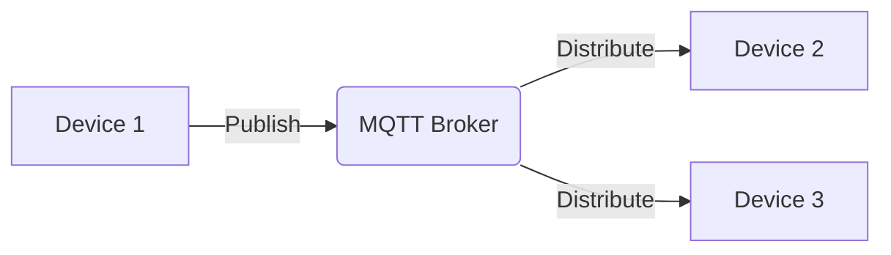
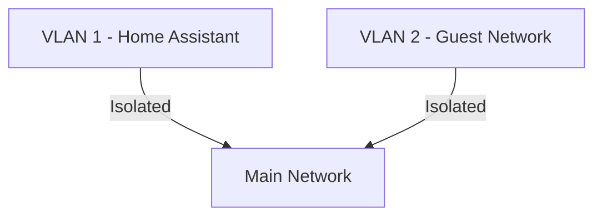

# IoT Networking: Smart Devices and Their Challenges

*Part 21 of the [networking and home lab series](2025-04-25-networking-and-home-lab-series.md).*

## What is IoT (Internet of Things)?

Imagine your kettle talking to your fridge. No, it's not the start of a bad joke; it's the Internet of Things (IoT). In simple terms, IoT refers to a network of physical objects—"things"—embedded with sensors, software, and other technologies to connect and exchange data with other devices and systems over the Internet. It's like having a team of very chatty assistants running around your house or workplace.

<!-- more -->

## Growth and Impact of IoT Devices

The growth of IoT has been monumental. From smart thermostats to industrial sensors, these devices are transforming how we live, work, and play. According to some estimates, there will be over 75 billion connected IoT devices by 2025. That's more than the number of cups of tea consumed in Britain each year!

But this growth comes with its fair share of challenges, especially when it comes to networking. Let's dive into how these devices connect and what hurdles they throw our way.

## IoT Connectivity

### Wi-Fi

Wi-Fi is like the bustling high street of IoT connectivity: ubiquitous, convenient, but often crowded. It provides ample bandwidth for data-hungry applications but can suffer from interference and range limitations.

### Zigbee and Z-Wave

These are like those narrow country lanes: less travelled but vital for specific routes. Zigbee and Z-Wave are low-power protocols ideal for home automation due to their mesh networking capabilities. However, they typically require a hub for internet connectivity.

### Cellular

Think of cellular networks as the motorways of IoT—fast, wide-reaching, but with tolls (data costs). Ideal for mobile or remote devices where Wi-Fi isn't available, cellular connectivity supports higher data rates but can be expensive.

### Other Technologies (Bluetooth, LoRaWAN)

- **Bluetooth**: Great for short-range connections; think headphones or smartwatches.
- **LoRaWAN**: Offers long-range communication at low power and is perfect for agricultural or environmental monitoring where devices are spread out like sheep on a hillside.

## IoT Protocols

### MQTT (Message Queuing Telemetry Transport)

MQTT is like a postal service for small packages—efficient and lightweight. Designed for constrained environments with limited bandwidth, it uses a publish-subscribe model. Devices publish messages to a broker, which then distributes them to subscribers.

### CoAP (Constrained Application Protocol)

CoAP is akin to HTTP's little brother—designed for simplicity and low overhead. It's ideal for small IoT devices with limited resources and supports multicast communications, making it suitable for group messaging.

## IPv6 and IoT

### Addressing the Scalability of IoT

Remember when everyone switched from analogue TVs? Well, IPv6 is the digital switchover for IP addresses. With billions more addresses available compared to IPv4, IPv6 ensures that we don't run out of addresses as IoT devices flood the market.

### IPv6 Adoption

Adoption has been slow—like getting kids to eat their veg—but it's happening. Many ISPs now offer IPv6 support, which is crucial as we integrate more IoT devices into our networks.

## IoT Security Challenges

### Vulnerabilities and Attacks

IoT devices can be as vulnerable as an open barn door without proper security measures. Common attacks include:

- **Botnets**: Devices hijacked to perform malicious activities.
- **Data breaches**: Sensitive information being leaked or stolen.
  
### Privacy Concerns

There's also the issue of privacy. Imagine your smart speaker eavesdropping on conversations about Aunt Mildred's dodgy knee—that's not something anyone wants!

### Device Management

Managing numerous devices can feel like herding cats. Ensuring firmware updates and consistent configurations across all devices is critical yet challenging.

## Securing IoT Networks

### Network Segmentation (VLANs)

Think of VLANs as fences in a field keeping different flocks apart. By segmenting your network, you can isolate IoT devices from critical parts of your system.

### Strong Authentication

Use strong authentication methods—like a shepherd's whistle—to ensure only authorised users can access your network.

### Regular Updates

Keep your systems updated regularly. It's like servicing your car; neglect leads to breakdowns at the worst times.

### Example: Securing IoT Devices on a Home Assistant Network

Consider setting up separate VLANs for your Home Assistant setup. It keeps your smart light bulbs from meddling with sensitive data traffic on your main network.

## Conclusion

Navigating the complexities of IoT networking isn't always straightforward—it's more like navigating Yorkshire moors in the fog! However, by understanding connectivity options, protocols, security challenges, and best practices, you can create robust and secure environments for your smart devices.

### Takeaways

- **Understand Protocols**: Use MQTT or CoAP where appropriate.
- **Embrace IPv6**: It's the future-proof solution.
- **Prioritise Security**: Segment networks and keep everything updated.
  
By keeping these tips in mind, you'll be well-equipped to handle the wild world of IoT networking without losing your bearings—or any data!
