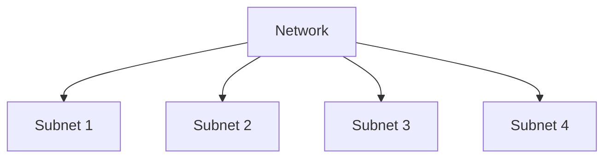

# IP Addresses and Subnetting Demystified

*Part 5 of the [networking and home lab series](2025-04-25-networking-and-home-lab-series.md).*

Networking can seem a bit like trying to understand the offside rule in football: it sounds simple until you try to explain it. Yet, just like mastering the offside trap, getting your head around IP addresses and subnetting is crucial for anyone dabbling in networking. So, grab a brew and let’s break down these concepts into digestible chunks.

<!-- more -->

## Introduction

### What is an IP address?

An IP address is essentially a unique identifier for a device on a network, much like how your home address identifies where you live. It allows data to find its way across the vast expanse of networks to reach the correct device. Think of it as the logical addressing system of the internet.

### Why are IP addresses necessary?

Without IP addresses, sending data over the internet would be akin to posting a letter with no address – it’d never reach its destination. They ensure every device can communicate efficiently and effectively, whether it’s your laptop streaming Netflix or your smart fridge ordering more milk.

## IP Address Structure

### IPv4 vs. IPv6

- **IPv4**: The older version, using 32 bits for an address (e.g., `192.168.1.1`), which supports about 4.3 billion unique addresses.
- **IPv6**: Introduced due to IPv4 exhaustion, using 128 bits (e.g., `2001:0db8:85a3:0000:0000:8a2e:0370:7334`), supporting a mind-boggling number of addresses.

The transition from IPv4 to IPv6 is much like shifting from a village of cottages to a sprawling city – plenty more room!

### Octets and Dotted Decimal Notation

IPv4 addresses are split into four octets (8-bit groups) separated by dots. Each octet can range from 0 to 255 – so next time you see `192.168.0.1`, think of it as four houses on a street.

### Network and Host Portions

IP addresses consist of two parts:

- **Network Portion**: Identifies the specific network.
- **Host Portion**: Identifies the specific device on that network.

Imagine a football team where the club name represents the network portion and individual player names are the host portion.

## IP Address Classes (A, B, C)

Back in the day, IP addresses were divided into classes to make allocation easier:

- **Class A**: Supports large networks with many devices (`1.0.0.0` to `126.0.0.0`)
- **Class B**: Supports medium-sized networks (`128.0.0.0` to `191.255.0.0`)
- **Class C**: Caters to smaller networks (`192.0.0.0` to `223.255.255.0`)

Each class had a default subnet mask defining which part of an address was network versus host – like default formations in football tactics.

## Subnetting

### Why Subnetting?

Subnetting divides a large network into smaller, manageable chunks:

- **Efficiency**: Reduces broadcast traffic, making each subnet less congested.
- **Security**: Isolates segments, preventing one compromised subnet from affecting others.

Think of subnetting as dividing fields for crop rotation – better yield and reduced risk of disease spreading.

### Subnet Mask Explained

A subnet mask defines which part of an IP address is network vs host:

- Example: Given `192.168.1.10` with subnet mask `255.255.255.0`, the first three octets (`192.168.1`) denote network, and the last (`10`) denotes host.

### Creating Subnets (Simple Examples)

To create subnets:
1. Determine how many subnets you need.
2. Borrow bits from the host portion for additional network portions.

For instance:
- Starting with `192.168.1.x`, use subnet mask `255.255.255.192` (or `/26`) for four subnets with 62 hosts each.

## CIDR (Classless Inter-Domain Routing)

### CIDR Notation (/8, /16, /24)

CIDR offers more flexibility than traditional class-based addressing by allowing arbitrary-length prefixes:

- `/8`: Large networks
- `/16`: Medium-sized
- `/24`: Smaller networks

### Benefits of CIDR (Flexibility)

CIDR helps in efficient address allocation and reduces wastage – akin to fitting more passengers on a bus without empty seats.

## Practical Applications

### Home Network Subnetting

For home setups:
- Use CIDR notation like `/24` for easy management.
- Separate IoT devices from personal computers to enhance security.

### Enterprise Network Examples

In enterprises:
- Allocate subnets per department using CIDR for scalability.
- Use VLANs alongside subnets for even greater control and isolation.

## Conclusion

Understanding IP addressing and subnetting forms the bedrock of robust network management – much like knowing your formations in football ensures tactical success on the pitch.

## TL;DR

IP addresses are essential for identifying devices on a network; subnetting splits large networks into manageable sections for efficiency and security; CIDR provides flexibility in address allocation.

So next time you're configuring your home router or planning an enterprise network, remember these fundamentals – they’ll keep your data flowing smoothly!
