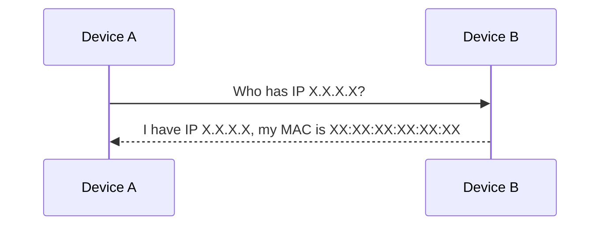

# MAC Addresses and ARP: Finding Devices on a Network

*Part 6 of the [networking and home lab series](2025-04-25-networking-and-home-lab-series.md).*

When you think of a MAC address, imagine it as the fingerprint of your device on a network. It's as unique as a bespoke football kit number, identifying each piece of kit in the field. While it's not the only factor that makes up your "team" (or network), it's crucial for determining who's who in the lineup.

<!-- more -->

This blog post will take you on a journey through the fascinating world of MAC addresses and ARP (Address Resolution Protocol). By the end, you'll understand how devices are identified on a network, why ARP is essential, and the potential pitfalls lurking in this seemingly straightforward process.

## MAC Address Definition

A **MAC address** (Media Access Control address) is often referred to as a physical address because it's hardwired into your device's network interface card (NIC). It's used to uniquely identify devices on a local network segment. Here's what you need to know:

- **Uniqueness and Purpose**: Each MAC address is supposed to be unique across all network interfaces worldwide. This uniqueness ensures that data packets reach the correct destination within a local network.
- **Analogy**: Think of a MAC address as the VIN (Vehicle Identification Number) of your car—unique to every vehicle and vital for identification.

## MAC Address Structure

### 48-Bit Address

A MAC address consists of 48 bits, typically represented as six pairs of hexadecimal digits. Imagine it like a postcode—it’s got its structure, and each part tells you something.

### OUI (Organizationally Unique Identifier)

The first three octets (24 bits) represent the **Organizationally Unique Identifier** (OUI). It identifies the manufacturer of the device. The rest is assigned by the manufacturer to ensure uniqueness. 

- **Example**: In `00-14-22-01-23-45`, `00-14-22` is the OUI, indicating the manufacturer.

## ARP (Address Resolution Protocol)

With all these unique identifiers flying around, you might wonder why we need anything else. Enter ARP—the protocol that bridges IP addresses with MAC addresses.

### Why ARP is Needed

While IP addresses are great for routing traffic across different networks, they don't directly map to how data physically travels along wires or through switches in your local network. That's where ARP comes into play:

- **Purpose**: Resolving an IP address to its corresponding MAC address, ensuring data packets reach their correct physical destination.
  
### ARP Request and Reply Process

Here's how it works:

1. **ARP Request**: A device broadcasts an ARP request packet asking, "Who has IP address X.X.X.X? Tell me your MAC."
2. **ARP Reply**: The device with IP X.X.X.X responds with its MAC address.

### ARP Tables

Devices maintain an **ARP table**, a sort of contacts list mapping IP addresses to MAC addresses for quick reference—much like keeping a list of regular players and their positions in your favourite Sunday league team.

## Layer 2 Networking

Layer 2 is where networking rubber meets the road—here's how switches and MAC addresses interact:

### Switches and MAC Address Forwarding

Switches use MAC addresses to forward data frames only to intended recipients within a local area network (LAN). They maintain a **MAC address table** which maps ports to MAC addresses, ensuring efficient delivery without unnecessary broadcasts.

### Broadcast Domains

A broadcast domain is the set of all devices that can reach each other by broadcast at layer 2. All devices on a single Ethernet switch share one broadcast domain unless VLANs are used.

## ARP Spoofing

Now for something more sinister—**ARP spoofing**, where attackers attempt to associate their own MAC address with an IP address belonging to another device on the network.

### What is ARP Spoofing?

An attacker sends fake ARP messages onto the network, tricking devices into sending data meant for another IP address to them instead.

### Potential Consequences

- **Man-in-the-Middle Attacks**: Intercepted traffic allows attackers to eavesdrop or alter communication.
- **Denial of Service**: Disrupts legitimate communication between devices.

### Basic Mitigation Techniques

- **Static ARP Entries**: Manually configure critical devices with fixed mappings.
- **Use Secure Protocols**: Encrypt sensitive traffic using SSL/TLS or VPNs.
  
> [!Caution]
> Despite being useful, static ARP entries can become cumbersome in large networks due to manual configuration complexity.

## MAC Filtering

Another layer of defence is **MAC filtering**, which controls access based on whether a device's MAC address appears on an allowed list.

### How MAC Filtering Works

Here's how it functions:

- Network hardware checks incoming frames against an allowed list before forwarding data.
  
### Limitations and Security Considerations

While helpful for basic security:
  
- **Spoofing Threats**: Attackers can spoof allowed MAC addresses.
  
> [!Tip]
> Use in combination with other security measures like strong encryption and regular monitoring for best results.

## Conclusion

As we've seen, understanding how MAC addresses and ARP work together is fundamental for managing and securing modern networks. Whether you're configuring your home IoT setup or managing enterprise-level infrastructure, awareness of these concepts helps prevent potential security issues.

### Key Takeaways

- **Essential Role**: MAC addresses are vital identifiers within local networks.
- **ARP's Importance**: Bridges logical IP addressing with physical hardware locations.
- **Security Awareness**: Stay vigilant against threats like ARP spoofing; consider layered security approaches including encryption and access control measures.

By mastering these basics, you're better equipped to tackle both everyday networking tasks and more advanced challenges down the line—much like knowing both when to pass short in midfield and when to hoof it clear from defence on a rainy day at St James' Park!
