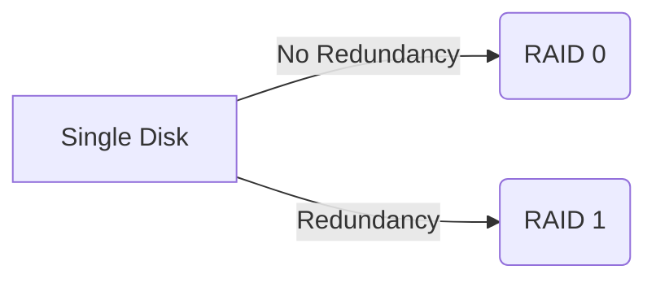

# NAS: What It Is and Why You Might Want One

*Part 20 of the [networking and home lab series](2025-04-25-networking-and-home-lab-series.md).*

Ah, Network Attached Storage, or NAS for short. It's one of those techy terms that sounds like it belongs in a sci-fi novel but is actually quite down-to-earth and incredibly useful. Whether you’re looking to keep your family photos safe, stream your favourite films across the house, or share files with your small business team without shouting across the office, a NAS might just be your new best friend.

<!-- more -->

## What is a NAS?

In plain English, a NAS is a dedicated storage device connected to your network. Think of it as a personal library where all your digital goodies live, accessible from any device connected to your home or office network. Unlike an external hard drive that connects directly to one computer, a NAS serves data over the network, making it the communal cookie jar for all things digital.

## Benefits of a NAS

- **Centralised Storage:** All your files in one place—no more "where did I save that?" moments.
- **Accessibility:** Files available to anyone on the network without needing to plug in and out like musical chairs.
- **Scalability:** Start small and expand as needed; just add more drives.
- **Energy Efficiency:** Consumes less power than a full-blown server.

## NAS Functionality

Alright then, let’s dive into what makes a NAS tick.

### Centralised Storage

Gone are the days of USB drives hidden in desk drawers. With a NAS, you have:

- **Easy Organisation:** Like having a well-labelled filing cabinet for everything digital.
- **Remote Access:** Access your files from anywhere with internet access (great for when you're off gallivanting).

### File Sharing

Think of this like passing notes in class but much more efficient and less likely to get confiscated by the teacher.

- **Collaboration:** Share documents with colleagues or family members easily.
- **Cross-device Compatibility:** Works with PCs, Macs, smartphones—whatever you’ve got.

### Media Streaming

Fancy turning your living room into a mini cinema? A NAS can transform into:

- **Media Server:** Stream films, music, and photos to smart TVs and media players.
- **Plex Integration:** With Plex Media Server, organise and stream content effortlessly.

### Backup Solutions

A bit like having an insurance policy for your data:

- **Automated Backups:** Scheduled backups mean no more manual saving.
- **Versioning & Snapshots:** Recover previous versions if you make a mess of something.

## Storage Protocols

Understanding some of the lingo here helps when setting things up.

### SMB (Server Message Block)

The go-to protocol for Windows machines. It allows seamless file sharing across networks—just like sharing biscuits at tea time.

### NFS (Network File System)

Favoured by Linux and Unix systems. It provides faster performance compared to SMB but requires a bit more setup elbow grease.

### AFP (Apple Filing Protocol)

For those living in Apple's orchard, AFP ensures smooth sailing when accessing files from Mac devices.

## NAS Use Cases

Let's look at where a NAS can really shine.

### Home Media Server (Plex)

Turn your home into an entertainment hub:

- Organise films and music with Plex.
- Stream content to any device around the house—perfect for family film night.

### Time Machine Backups

For Mac users who want easy-peasy backups:

- Set up Time Machine to back up directly to the NAS without lifting a finger.

### Personal Cloud Storage

Imagine Dropbox but without monthly fees:

- Store and access files from anywhere.
- Maintain control over who gets access—no peeking neighbours here!

### Small Office File Sharing

Ideal for small teams needing shared resources:

- Central file repository reduces email clutter.
- Enables collaborative work on documents without duplication nightmares.

## NAS Hardware and Configuration

Choosing the right gear is crucial—like picking the right size welly boots for mucking about in fields.

### Drive Configurations (RAID)

RAID isn't just about avoiding traffic jams:

- **RAID 0:** Speed boost but no redundancy—like driving fast with no seatbelt.
- **RAID 1:** Mirroring for redundancy—two drives holding identical data.
  
Mermaid Diagram:

### Network Connectivity

Ensure your NAS has good Wi-Fi or Ethernet capabilities—it’s how it talks to everything else.

### NAS Operating Systems (e.g., Synology DSM)

Like choosing between Android or iOS but for storage:

- Intuitive interfaces make management straightforward.
  
## NAS Considerations

Before you rush out to buy one, here are some things to chew over:

### Cost

Not just initial purchase but potential upgrades over time. Don’t buy more than you need initially; you can scale later.

### Performance

Consider what you'll use it for—media streaming demands more horsepower than simple file storage.

### Security

With great power comes great responsibility:

- Ensure firmware updates are regular.
- Set up user permissions carefully to avoid unwanted guests snooping around.

## Conclusion

A NAS is like having your own private server without the faff of running one. It’s versatile enough for both home use and small office setups, offering benefits from centralised storage to media streaming. So whether you're looking to beef up your backup game or just want easier access to your files from anywhere, a NAS could be just what you need—without breaking the bank or requiring an IT degree.

---

**Takeaway Summary:**

1. **Centralised Storage & Sharing**: Keep all digital assets in one place while ensuring easy access across devices.
2. **Versatile Use Cases**: From media servers to personal cloud storage—even small business solutions.
3. **Cost & Security**: Mindful investment with attention towards security settings will pay dividends in peace of mind.

There you have it—a comprehensive look at why a NAS might be worth considering next time you're pondering how best to manage your digital life. Grab yourself a brew and mull it over!
