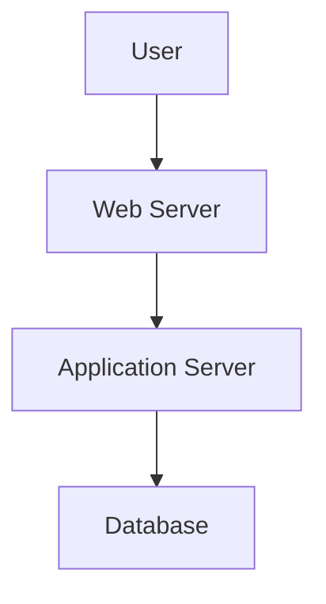

# Network Tools and Automation in Docker

*Part 29 of the [networking and home lab series](2025-04-25-networking-and-home-lab-series.md).*

## Introduction

Ah, the allure of a well-oiled smart home and network that runs as smoothly as your favourite football team on a good day. But let's face it, managing networks can sometimes feel like herding cats—unpredictable and occasionally chaotic. Enter Docker, your new best mate for taming network chaos with automation and documentation. Whether you're a tinkerer, a home automation enthusiast, or just someone who likes to keep things organised, Dockerised tools can really make your life easier.

<!-- more -->

In this blog post, we'll explore how you can leverage Docker to automate your smart home, document architectures, and track those pesky IP/network changes. Ready? Let’s dive in.

## Enhancing Network Management with Docker

Docker is like having a toolbox with all your favourite spanners and screwdrivers neatly arranged—everything's contained, reproducible, and portable. By containerising network management tools, you not only streamline deployment but also enhance scalability and maintainability.

### Automation and Documentation

- **Automation**: Automate repetitive network tasks using visual programming or integrated systems.
- **Documentation**: Capture and visualise network architecture to avoid the "what does this wire do?" syndrome.

## Network Automation

### Node-RED

Node-RED is like the Swiss Army knife of network automation—versatile and powerful. It’s a flow-based programming tool that lets you connect hardware devices, APIs, and online services in new and interesting ways. Perfect for visual learners who prefer not to drown in lines of code.

- **Visual Programming**: Drag-and-drop interface to create automation flows.
- **Integration**: Connects easily with various IoT devices and services.

### Home Assistant Integration

Home Assistant is your go-to platform for smart home control. Integrating Node-RED with Home Assistant is like putting peanut butter with jam—each great on its own but even better together.

- **Control Centre**: Manage all smart devices from one interface.
- **Automation**: Use Node-RED flows to automate tasks like turning lights on at sunset or adjusting the thermostat when you leave home.

## Network Documentation

### Structurizr

Documenting network architecture can be tedious work akin to writing assembly instructions for flat-pack furniture. Structurizr simplifies this by allowing you to create C4 model diagrams that are both comprehensive and easy on the eyes.



### Archi (Brief Mention)

For those who prefer ArchiMate for enterprise architecture modelling, Archi is worth a look. It's a bit more heavyweight but offers robust features for those deep dives into complex systems.

## Network Monitoring

### IP Snap

Is there anything more annoying than an IP address change wreaking havoc on your carefully curated setup? IP Snap helps track these changes so you're never caught off guard again.

- **IP Tracking**: Monitors IP address changes in real-time.
- **Alerts**: Get notified when changes occur.

### Rejex (Log Analysis)

Think of Rejex as the log detective—sifting through data to find clues about what's going wrong (or right) in your system.

- **Log Parsing**: Analyse logs efficiently using regex patterns.
- **Insightful Reporting**: Generate reports to identify trends or issues.

## Setup and Configuration

Deploying these tools using Docker Compose is like setting up a production line—each component has its place, making it easy to manage and update.

```yaml
version: '3'
services:
  nodered:
    image: nodered/node-red
    ports:
      - "1880:1880"
  homeassistant:
    image: homeassistant/home-assistant
    ports:
      - "8123:8123"
```

### Connecting Tools Together

The beauty of Docker is how easily these tools can be interconnected:

- Use Node-RED to trigger actions in Home Assistant.
- Monitor changes with IP Snap alerts feeding into structured notifications.
  
## Use Cases

### Smart Home Automation Flows

Create flows that automate mundane daily tasks:

- Turn off lights when no movement is detected for 30 minutes.
- Automatically lock doors at night.

### Network Architecture Diagrams

Visualise your network setup:

- Map out connections using Structurizr diagrams.
- Document dependencies between services.

### Change Management

Track network changes:

- Use IP Snap to log address alterations.
- Analyse logs with Rejex for performance tweaks.

## Best Practices

### Security

Like locking the barn door before the horse bolts:

- Ensure containers are updated regularly.
- Limit access to sensitive components with firewalls.

### Version Control for Flows/Diagrams

Keep track of changes and revisions:

- Use Git repositories for managing Node-RED flows.
- Track Structurizr diagram versions similarly.

### Documentation

Don’t skip documenting setups; future-you will thank present-you:

- Maintain clear descriptions within Node-RED flows.
- Use markdown files alongside diagrams for detailed explanations.

## Conclusion

By now, you should have a solid grasp of how Dockerised tools can simplify automating, documenting, and monitoring your network setup. Whether you're just starting out or already knee-deep in cables and configurations, these tools provide a robust framework for managing complexity without losing sight of the bigger picture. So grab a cuppa, fire up Docker, and start tinkering—your future self will thank you!

---

### Takeaway Summary
Docker offers a comprehensive solution for automating network management tasks, documenting architectures, and tracking changes efficiently. By integrating tools like Node-RED, Home Assistant, Structurizr, IP Snap, and Rejex into your workflow, you can achieve greater control over your environment while keeping everything tidy and manageable.
