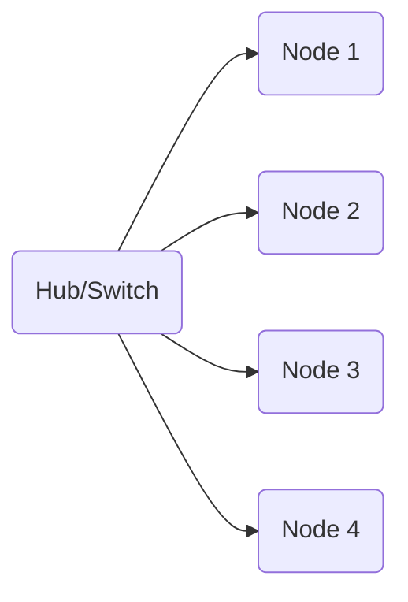
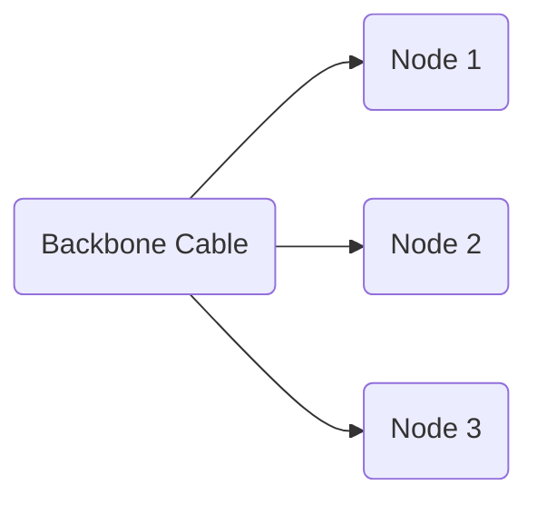
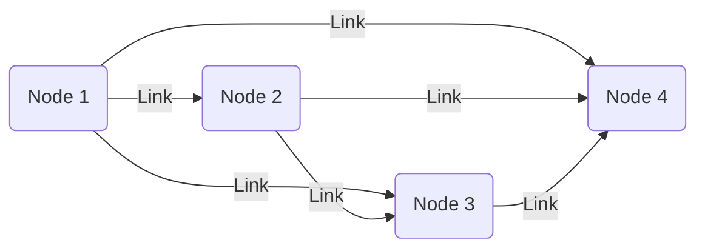

# Network Topologies: Star, Bus, Mesh and More

*Part 2 of the [networking and home lab series](2025-04-25-networking-and-home-lab-series.md).*

So, you're curious about network topologies. Fair enough—it's the kind of topic that can seem as tangled as a football club's finances. But once you get your head around it, you'll see it's not just about connecting computers; it's about choosing the right structure to keep data flowing smoothly. Let's dig in.

<!-- more -->

## Introduction

### What is Network Topology?

To put it simply, network topology is how you arrange and connect the various parts of a network. Think of it like a road map for data packets, showing them how to get from A to B.

- **Physical Topology**: This is all about the actual layout—the cables, switches, routers and whatnot.
  
- **Logical Topology**: This focuses on how data moves within the network, regardless of its physical design, similar to how traffic might flow through a city's road system.

### Why Topology Matters

Choosing the right topology affects two main things:

- **Performance**: Some layouts are faster or more efficient than others.
  
- **Reliability**: Some designs can keep working even if parts of the network fail; others can't.

## Star Topology

### Description

The star topology has a central hub or switch that connects directly to each node (like computers or printers). It's like having one referee who everyone communicates with directly in a football match.

### Pros

- **Easy Management**: Adding or removing devices is straightforward.
  
- **Fault Isolation**: If one cable fails, only its connected device goes offline—a bit like losing one player to a red card but still being able to play the match.

### Cons

- **Single Point of Failure**: If the hub fails, everything grinds to a halt—akin to losing the referee and nobody knowing what to do next.

### Use Cases

- **Home Networks**: Most home routers use this setup.
  
- **Office LANs**: Perfect for small to medium-sized businesses where simplicity and ease of management are key.

## Bus Topology

### Description

Bus topology uses a single central cable (backbone) that all devices tap into—similar to neighbours sharing one water pipeline.

### Pros

- **Simple and Cheap**: Less cabling means lower costs.
  
- **Ease of Installation**: Quick setup compared to more complex systems.

### Cons

- **Scalability Limits**: More devices mean more collisions—like too many cars on a single-lane road.
  
- **Fault Vulnerability**: If the main cable breaks, everything stops—a bit like cutting that shared water pipe.

### Historical Use Cases

In days gone by, bus topology was common in smaller networks because of its simplicity and cost-effectiveness. However, it's largely been phased out in favour of more robust systems.

## Mesh Topology

### Description

In mesh topology, every node connects directly to every other node. Imagine it as a robust web where every spider has its own silk line to each other spider!

### Pros

- **High Redundancy and Reliability**: Loads of alternative paths if one goes down.
  
- **Robust Performance**: Excellent for high-demand or critical systems.

### Cons

- **Complexity and Cost**: All those connections require lots of cabling and configuration—like building an elaborate model railway set.

### Use Cases

- **Critical Systems**: Often used in military communications or financial industries where uptime is crucial.
  
- **Some Wireless Setups**: Mesh Wi-Fi networks use this principle for better coverage and reliability at home.

## Other Topologies (Briefly)

Let's take a quick look at some other topologies:

- **Ring Topology**: Nodes form a circle. Data travels in one direction until it reaches its destination. Useful for some types of local area networks (LANs), but less popular now due to potential failure points.
  
- **Hybrid Topology**: Combines elements of different topologies (e.g., star-bus). Offers flexibility but can be complex.
  
- **Tree Topology**: Hierarchical structure resembling an actual tree (rooted at one point). Commonly used in corporate networks with multiple branches or departments.

## Comparison Table

Here's a handy table comparing these topologies:

| Topology      | Pros                                   | Cons                                    |
|---------------|----------------------------------------|-----------------------------------------|
| Star          | Easy management, fault isolation       | Single point of failure                 |
| Bus           | Simple, cheap                          | Scalability limits, fault vulnerability |
| Mesh          | High redundancy, reliability           | Complex, expensive                      |
| Ring          | Predictable performance                | One break affects entire network        |
| Hybrid        | Flexible                               | Complex                                |
| Tree          | Scalable                               | Complex configuration                   |

## Conclusion

When choosing a network topology:

- Consider your specific needs—performance versus cost versus reliability.
  
- Smaller setups might favour star or hybrid designs due to their simplicity and ease of expansion.
  
- Larger or mission-critical environments might lean towards mesh for its reliability despite higher costs.

Ultimately, just like deciding whether your Sunday League team should play defensively or go all-out attack, there's no one-size-fits-all answer. It's all about what's best suited for your needs and resources.

---

## TL;DR / Takeaway Summary

Network topologies define how devices connect within a network. Key types include:

1. **Star Topology** - Centralised control but vulnerable if the hub fails.
   
2. **Bus Topology** - Simple but not scalable.
   
3. **Mesh Topology** - Extremely reliable but costly and complex.

Each has its strengths and weaknesses, just like choosing between pie flavours at your local chippy—it's all about what suits your taste!
