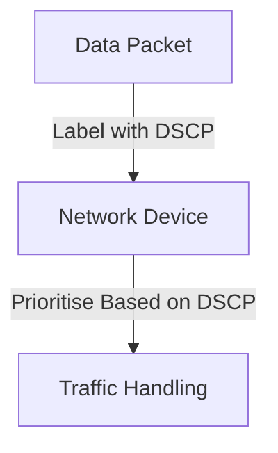

# QoS: Prioritising Traffic for Smooth Performance

*Part 18 of the [networking and home lab series](2025-04-25-networking-and-home-lab-series.md).*

Picture this: you're on an important video call, and suddenly, your screen freezes. Or maybe you're in the middle of a heated online game, and your character lags just as you're about to secure victory. Annoying, right? This is where Quality of Service (QoS) comes into play. It's the unsung hero working behind the scenes to ensure your critical network traffic gets the red-carpet treatment it deserves.

<!-- more -->

## What is QoS?

Quality of Service, or QoS, is a set of technologies used to manage network resources by prioritising certain types of data traffic. Think of it like a motorway with dedicated lanes for emergency vehicles — it ensures that vital services can always get through, even when things are busy.

### Why is QoS Important?

In today's world, many applications rely on real-time data transmission:

- **VoIP (Voice over IP):** Needs consistent connectivity for clear conversations.
- **Video Conferencing:** Requires stable bandwidth to avoid awkward freeze frames.
- **Online Gaming:** Demands low latency to keep gameplay smooth.
- **Streaming Media:** Needs continuous data flow for uninterrupted viewing.

Without QoS, these applications might suffer from delays and interruptions due to competing traffic demands.

## QoS Mechanisms

Implementing QoS involves several mechanisms that work together like a well-oiled machine:

### Prioritisation

This is about deciding which packets get sent first. Imagine being at a theme park where some folks have fast passes — they skip the queue while others wait. Similarly, QoS prioritises data packets based on their importance.

### Bandwidth Allocation

Here we divide the available bandwidth among different services. It's like splitting a pie fairly among your mates — everyone gets what they need without anyone going hungry.

### Traffic Shaping

Traffic shaping smooths out the data flow across the network. It’s akin to pacing yourself during a long-distance run — you don’t sprint at the start only to run out of steam halfway through.

### Queuing

Packets are placed in queues based on priority levels. High-priority packets get served first, similar to how emergency patients are treated before less critical cases in A&E.

## DSCP (Differentiated Services Code Point)

To effectively prioritise traffic, you need a way to mark it. Enter DSCP — think of it as putting labels on parcels to indicate which ones are fragile and need careful handling.

### Marking Traffic for Priority

DSCP tags each packet with a value indicating its priority level. Network devices then use these values to decide how to handle each packet.

### DSCP Values

Different DSCP values correspond to various levels of service:

- **EF (Expedited Forwarding):** Top priority for critical traffic like VoIP.
- **AF (Assured Forwarding):** For important but less time-sensitive data.
- **BE (Best Effort):** Standard service for regular traffic.

## QoS Applications

Let's look at some real-world scenarios where QoS makes a difference:

### VoIP (Voice over IP)

QoS ensures that voice packets are prioritised so that your calls remain clear and free from jitter or delay.

### Video Conferencing

By allocating sufficient bandwidth and prioritising video streams, QoS helps prevent those embarrassing "Sorry, I lost you there" moments.

### Online Gaming

Low latency is crucial here; with QoS, you minimise lag and maximise your chances of victory.

### Streaming Media

QoS ensures that streaming services deliver content smoothly without buffering interruptions.

## QoS Configuration

Getting QoS set up correctly is crucial. Here's how you can configure it:

### Router Settings

Most modern routers come with built-in QoS settings. Look for options to enable QoS and set priorities for different types of traffic.

### Network Devices

Ensure all network devices support and respect DSCP values. This might involve updating firmware or configuring settings manually.

## QoS Challenges

While QoS offers significant benefits, it's not without its challenges:

### Complexity

Configuring QoS can be complex and requires a good understanding of networking principles. It's not just about flipping a switch — it’s more like tuning an orchestra for harmony.

### Over-Provisioning vs. QoS

Some might argue that simply increasing bandwidth (over-provisioning) could solve issues without implementing QoS. However, this isn’t always cost-effective or practical and doesn't address prioritisation needs during peak times.

## Conclusion

Implementing Quality of Service in your network can significantly enhance performance for critical applications by ensuring they receive the necessary bandwidth and priority. While setting up QoS might require some initial effort and understanding, the long-term benefits make it worthwhile — smoother video calls, seamless gaming experiences, and uninterrupted streaming sessions await those who embrace it.

> **Takeaway:** If you rely heavily on real-time applications, consider implementing QoS in your network setup. It could be the difference between frustration and flawless performance.
