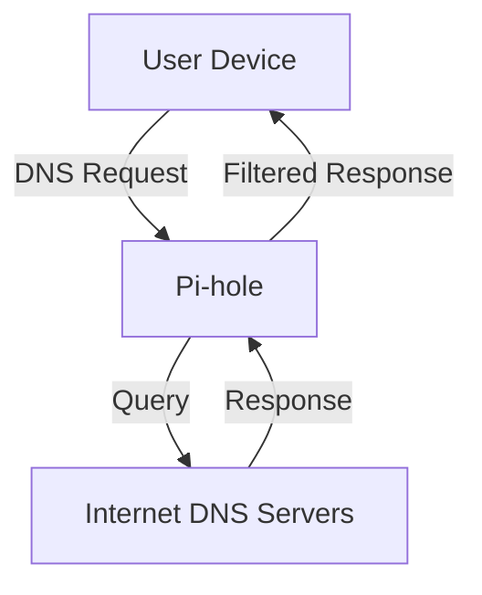

# Running a Local DNS and DHCP Server for Your Home Lab

*Part 24 of the [networking and home lab series](2025-04-25-networking-and-home-lab-series.md).*


## Introduction

If you've ever dreamt of having your own little digital kingdom at home, complete with faster internet lookups and customised network configurations, then setting up a local DNS and DHCP server might just be the answer. It's like having your own football pitch where you decide who plays, when they play, and what the rules are. In this post, we'll explore how to harness the power of DNS and DHCP for your home lab or advanced home setup, giving you control, speed, and a sprinkle of geeky magic.

<!-- more -->

### Benefits of Running a Local DNS and DHCP Server

- **Control**: You're the gaffer here. Decide which devices connect and how they're identified.
- **Speed**: Local lookups can be much quicker than relying on external servers.
- **Customisation**: Tailor your network settings to fit your unique needs.

So, let's dive in and take a closer look at how to set this up.

## DNS and DHCP Basics

Before we start fiddling with cables and software installs, let's recap the basics.

### Recap of DNS and DHCP Functions

- **DNS (Domain Name System)**: Translates human-friendly domain names (like `www.example.com`) into IP addresses that computers understand.
- **DHCP (Dynamic Host Configuration Protocol)**: Automatically assigns IP addresses to devices on your network, ensuring they can communicate with each other without you playing referee every time one connects.

### Standard Network Configuration

Imagine your network as a well-organised post-office system:
- **DNS** is like the address book used by postmen to deliver letters.
- **DHCP** is akin to assigning pigeonholes for new employees in an office.

## Tools for Local DNS and DHCP

When it comes to picking your tools, you've got some excellent options that won't break the bank. Two popular choices are Dnsmasq and Pi-hole.

### Dnsmasq

Dnsmasq is lightweight yet powerful. It's like the Swiss Army knife of network services:
- Provides both DNS caching and DHCP services
- Perfect for small networks
- Easy to configure with minimal overhead

### Pi-hole (with DNS/DHCP Features)

Pi-hole is originally designed as an ad-blocker but comes with built-in DNS/DHCP capabilities:
- Blocks unwanted ads across all devices
- Offers an easy-to-use web interface
- Can replace your router's own DNS/DHCP services

## Setup and Configuration

Let's get our hands dirty now. We'll walk through setting up either Dnsmasq or Pi-hole.

### Installing and Configuring Dnsmasq

Here’s how you can set up Dnsmasq:

1. **Install Dnsmasq**:
   ```bash
   sudo apt-get install dnsmasq
   ```

2. **Configure `/etc/dnsmasq.conf`**:
   - Define DHCP range:
     ```
     dhcp-range=192.168.1.50,192.168.1.150,12h
     ```

3. **Set Up Local DNS Records**:
   - Add entries like:
     ```
     address=/myserver.local/192.168.1.10
     ```

4. **Restart Dnsmasq**:
   ```bash
   sudo systemctl restart dnsmasq
   ```

## Setting Up Pi-hole

For those using Pi-hole:

1. **Installation**: Follow the [official guide](https://pi-hole.net).
2. **Configure DHCP**: Enable DHCP from the Pi-hole admin interface.
3. **Local DNS Records**: Add custom entries via the admin panel.

## Advanced Features

Once you're up and running, there's more magic to explore.

### Conditional Forwarding

Want specific queries to go elsewhere? Use conditional forwarding to send requests to different upstream servers based on domain names.

### DNS Caching

Speed up repeated lookups by caching previous responses locally, reducing latency significantly.

### Local Domain Management

Manage local domains without needing an internet connection—a boon if you're testing IoT setups or developing web apps in-house.

## Home Lab Examples

You might wonder how these tools fit into real-world scenarios—let's tackle that next.

### Integrating with Docker Containers

Route container traffic through your local DNS for consistent naming conventions across services.

### Using with a Synology NAS

Enhance your NAS capabilities by integrating it with your local DNS setup for better file sharing and application hosting.

### Pi-hole on a Raspberry Pi (Given Your Setup!)

A Raspberry Pi running Pi-hole is like having a mini server that keeps everything tidy while sipping tea quietly in the corner.



## Troubleshooting

Even the best-laid plans can hit a snag or two—here are common issues:

- **No Internet? Double-check** if another device is acting as a DHCP server.
- **Slow Lookups? Ensure caching** is enabled and properly configured.
- **Devices Not Receiving IPs? Revisit** your DHCP range settings.

## Conclusion

By setting up a local DNS and DHCP server, you're essentially empowering yourself with greater control over your network environment—faster lookups, customised configurations, and enhanced privacy are just some of the benefits you'll enjoy.

---

## Takeaway Summary

Running a local DNS and DHCP server isn't just for techies tinkering in their lofts; it's about making technology work smarter for you at home. Whether you're blocking ads across devices or managing multiple gadgets seamlessly, this setup brings order to the chaos of modern connectivity—just like refereeing a Sunday league match where everyone knows their place on the field.
