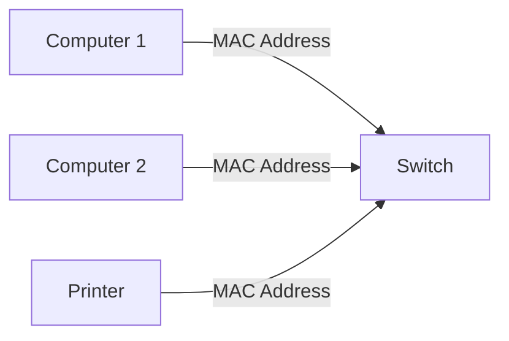

# Switches and Routers: What’s the Difference and Why It Matters

*Part 3 of the [networking and home lab series](2025-04-25-networking-and-home-lab-series.md).*

Welcome to the world of networking—a bit like plumbing, but for data. Whether you're setting up a home network or managing a corporate behemoth, understanding the roles of switches and routers is crucial. Much like how a football team needs both defenders and forwards to function correctly, your network depends on these trusty devices to keep data flowing smoothly.

<!-- more -->

## Introduction

In this post, we'll explore:

- **Switches:** The backbone of local area networks (LANs), handling data traffic within your network.
- **Routers:** The gateway between different networks, routing data from one network to another.
- **Key Differences:** Why it's essential to know which device does what.
- **NAT (Network Address Translation):** A little trick routers play to keep everything running smoothly.

Let's dive into each component and see why they matter in your setup.

## Switches

A switch is your local postman—delivering data packets precisely where they need to go within a network. They're all about efficiency and speed.

### Definition and Function (Layer 2)

- **Layer 2 Device:** Operates on the data link layer according to the OSI model. This means it deals with MAC addresses, not IP addresses.
- **Purpose:** To connect devices within the same network, enabling them to communicate effectively.

### MAC Addresses and Forwarding

- **MAC Address:** A unique identifier assigned to network interfaces for communications on the physical network segment.
- **Forwarding:** Switches use MAC addresses to determine where to send data packets. They learn which devices are connected to which ports and build a MAC address table.

### LAN Operations

Imagine a village where everyone knows everyone else's house by sight—that's your LAN. Switches ensure that when one villager wants to chat with another, the message goes directly there without bothering the whole street.

### Managed vs. Unmanaged Switches

- **Managed Switches:** Offer control over network traffic with features like VLANs, Quality of Service (QoS), and monitoring tools.
- **Unmanaged Switches:** Simpler devices that require no configuration—plug and play. Perfect for straightforward setups like home networks.

### Mermaid Diagram: Simple Network with Switch

## Routers

While switches are busy handling traffic within your local village, routers are like border control—ensuring that messages heading out or coming in are routed correctly between different networks.

### Definition and Function (Layer 3)

- **Layer 3 Device:** Operates on the network layer using IP addresses.
- **Purpose:** Connects multiple networks together, directing data from source to destination across network boundaries.

### IP Addresses and Routing

- **IP Address:** A unique identifier for a device on a TCP/IP network.
- **Routing:** Routers determine the best path for data packets based on IP addresses, akin to finding the quickest route through city streets.

### Connecting Different Networks (LANs, WANs)

Routers make sure that when you want to send data from your home office in Manchester to a server in London, it takes the most efficient route possible over various interconnected networks (the internet).

### Home Router Functions

Your home router is a multi-talented beast:

- Acts as a router by connecting your home LAN to your Internet Service Provider's (ISP) network.
- Often includes built-in switches for connecting multiple wired devices.
- Provides Wi-Fi access for wireless devices.
  
## Key Differences

Understanding these differences helps when choosing equipment:

### Layer 2 vs. Layer 3

- **Switches (Layer 2):** Handle local traffic within a single network using MAC addresses.
- **Routers (Layer 3):** Route traffic between different networks using IP addresses.

### MAC vs. IP Addressing

- **Switches:** Use MAC addresses to forward packets internally.
- **Routers:** Use IP addresses for directing packets externally.

### LAN vs. WAN Focus

- **Switches:** Keep it local—focused entirely on LAN operations.
- **Routers:** Bridge the gap between LANs and WANs, managing internet connectivity.

## NAT (Network Address Translation)

NAT is like having one postal address for an entire apartment block but ensuring each flat gets its letters.

### Why NAT is Needed

With more devices than available public IP addresses, NAT allows multiple devices on a private network to share a single public IP address for accessing external networks.

### Basic Explanation

1. Devices within your LAN use private IPs.
2. When accessing external networks (like the internet), NAT translates these private IPs into one public IP address.
3. Replies from external servers are then translated back by NAT into the corresponding private IPs inside your LAN.

## Conclusion

When setting up or managing networks:

- **Use Switches** for internal communications within a LAN. They're essential for expanding your wired connections without fuss.
  
- **Deploy Routers** when connecting different networks or needing internet access. They manage traffic efficiently, ensuring data reaches its correct destination across various paths.

Both devices play vital roles in any well-oiled network setup, whether it's at home or in an enterprise environment. Understanding their functions ensures you can tailor your network infrastructure effectively—keeping everything running as smoothly as a well-executed football strategy.

---

### Takeaway Summary

In essence:

- **Switches**: Local traffic controllers using MAC addresses; perfect for internal communication.
  
- **Routers**: Network connectors using IP addresses; essential for external communications and internet access.

And remember, NAT keeps everything tidy by sharing one public face for many private ones—a real team player!

That's all you need from me today—now go forth and build those networks!
