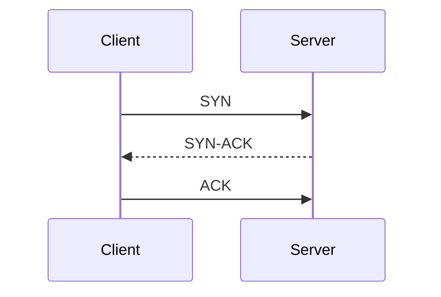

# TCP vs UDP: Choosing the Right Transport Protocol

*Part 9 of the [networking and home lab series](2025-04-25-networking-and-home-lab-series.md).*

In the world of networking, choosing the right transport protocol is a bit like picking the ideal vehicle for your journey. Need to transport delicate goods across town? Perhaps a well-sprung van would do. Racing against time? A nimble motorbike might be your best bet. Similarly, when it comes to data transmission over networks, TCP (Transmission Control Protocol) and UDP (User Datagram Protocol) are our two trusty steeds.

<!-- more -->

Understanding these protocols is essential for anyone dealing with networked applications—whether you’re streaming yesterday’s match highlights or transferring important documents. Let’s dive into each protocol, explore their strengths and weaknesses, and see how they stack up against each other.

## TCP (Transmission Control Protocol)

### Connection-Oriented

TCP is akin to having a dedicated phone line where both parties ensure they're listening before chatting away—think of it as making sure you’ve got someone’s attention before spilling the beans.

- **Handshake**: Establishes a connection using a three-way handshake (SYN, SYN-ACK, ACK).
- **Dedicated Channel**: Guarantees that both sender and receiver are ready to communicate.

### Reliable Data Transfer

TCP prides itself on reliability. It’s a bit like hiring a courier who confirms receipt with every delivery.

- **Acknowledgments**: Every packet sent is acknowledged.
- **Retransmissions**: Lost packets are resent until acknowledged.
- **Error Checking**: Ensures that data arrives intact.

### Sequencing and Flow Control

TCP doesn’t just dump data at the receiver's door; it ensures everything arrives in order and at a manageable pace.

- **Sequencing**: Packets are numbered so they can be reordered if they arrive out of sequence.
- **Flow Control**: Adjusts data flow based on network congestion and receiver capacity.

### Overhead and Acknowledgments

All this reliability comes at a cost—overhead. TCP's checks and balances mean more data overhead, making it less speedy than its counterpart.

### Use Cases

Ideal for scenarios where accuracy matters more than speed:

- Web browsing
- Email
- File transfers

## UDP (User Datagram Protocol)

### Connectionless

UDP shrugs off the formalities—no handshakes here. It sends packets as if tossing letters into postboxes without checking if anyone’s home.

### Unreliable Data Transfer

UDP offers no guarantees. If a packet goes missing, tough luck—it won’t come knocking again.

### Low Overhead and Speed

UDP travels light and fast, perfect for when timing trumps precision:

- **No Acknowledgments**: Eliminates need for confirmations.
- **Minimal Error Checking**: Less overhead means faster delivery.

### Use Cases

When speed is king and minor losses are tolerable:

- Streaming media
- Online gaming
- Voice over IP (VoIP)

## Comparison

Choosing between TCP and UDP boils down to balancing reliability against speed. Here’s how they compare:

| Feature            | TCP                                         | UDP                                |
|--------------------|---------------------------------------------|------------------------------------|
| Connection         | Connection-oriented                         | Connectionless                     |
| Reliability        | High                                        | Low                                |
| Overhead           | High                                        | Low                                |
| Order              | Guarantees order                            | No order guarantees                |
| Use Cases          | Web browsing, email, file transfer          | Streaming, gaming, VoIP            |

### When to Use Each Protocol

Here’s a quick guide:

- **Choose TCP** if you need guaranteed delivery and data integrity. Think about sending invoice files or accessing websites.
  
- **Opt for UDP** when speed is critical and occasional losses are acceptable. Streaming your favourite show or battling in an online game are prime examples.

## Conclusion

Selecting the right transport protocol isn’t just about understanding technical differences; it’s about aligning those differences with your application’s needs. Much like deciding whether to take the scenic route or motorway on a road trip, it’s all about priorities—reliability or speed?

Remember:

- Use TCP for accuracy, order, and reliability.
- Choose UDP for speed and efficiency where minor losses don’t matter.

With these insights under your belt, picking the right protocol should feel less like rocket science and more like choosing between tea or coffee—it all depends on what suits your needs best!

### Takeaway Summary

In essence:

- TCP ensures reliable communication with more overhead.
- UDP prioritises speed with less assurance.
- Match your choice to the application's requirements—precision or performance?

Don’t forget to consider network conditions and end-user experience when deploying either protocol in real-world scenarios. Happy networking!
