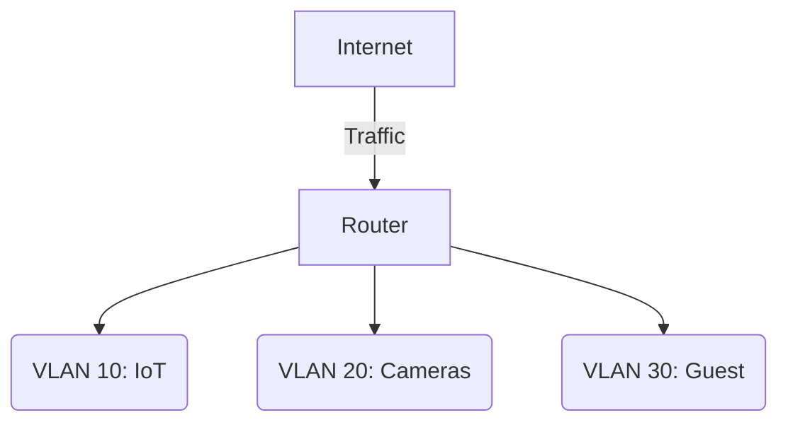

# Using VLANs and Subnets for Smart Home Security

*Part 23 of the [networking and home lab series](2025-04-25-networking-and-home-lab-series.md).*

Alright, folks, let's have a natter about your smart home network security. Picture your smart home as a bustling football match. You've got players (devices) all over the pitch (network), and without proper strategy (security measures), it's utter chaos. Imagine the goalkeeper (your data) unprotected – not ideal, right? Today, we'll explore how VLANs and subnets can be your network's best defence, keeping your IoT gadgets in line and your data safe.

<!-- more -->

## Security Challenges in Smart Home Networks

Smart homes are fantastic, aren't they? You can control everything from lights to the kettle with a tap on your phone. However, these conveniences come with their own set of challenges:

- **Numerous Devices**: From smart fridges to security cameras, you might have dozens of devices connected.
- **Vulnerabilities**: Each device could be a potential entry point for hackers.
- **Data Privacy**: Sensitive information could be exposed if not properly secured.

## Importance of Segmentation

Just like a good pie has distinct layers, so should your network. Segmenting your network through VLANs and subnets isolates devices, minimising risk. Imagine it as having separate sheds for different tools rather than a cluttered garage – much easier to manage.

## VLANs for Smart Home Security

Virtual LANs (VLANs) allow you to partition your network logically rather than physically. It's like having invisible walls between rooms in your house.

### Isolating IoT Devices

- **Why Isolate?**: Many IoT devices have limited security features, making them easy targets.
- **How to Isolate**: Use VLANs to separate these devices from more secure ones like personal computers or NAS units.

### Creating Guest Networks

Ever had guests over who need Wi-Fi access? Instead of offering them the keys to your digital kingdom, create a guest network:

- **Guest VLAN**: Set up a separate VLAN for guests to keep their traffic away from your main network.
- **Access Control**: Limit what guests can access; they shouldn't be able to snoop around your IoT devices.

### Segmenting Cameras and Other Sensitive Devices

Cameras and other sensitive devices should have their own VLAN. This is akin to putting them in Fort Knox compared to the general house:

- **Dedicated VLAN**: Keep these high-risk devices isolated.
- **Limited Access**: Only allow necessary communication paths.

### Example - VLAN Configuration on an Asus Router for a Smart Home

Here's how you could configure VLANs on an Asus router:

1. **Access Your Router's UI**: Typically via a web browser pointing at its IP address.
2. **Navigate to LAN Settings**: Look for VLAN configuration options.
3. **Create New VLANs**:
   - **VLAN 10**: IoT Devices
   - **VLAN 20**: Cameras
   - **VLAN 30**: Guest Network
4. **Assign Ports/SSIDs**: Map specific ports or wireless SSIDs to each VLAN.



## Subnetting for Smart Home Security

Subnets allow even finer control within VLANs by dividing them into smaller networks.

### Further Segmentation within VLANs

- **Micro-segmentation**: Even within a single VLAN, you can use subnets to create further divisions.
- **Example Setup**:
  - Subnet 192.168.10.0/24 for IoT.
  - Subnet 192.168.20.0/24 for cameras.

### IP Address Management

Managing IP addresses becomes more efficient with subnets:

- **Static vs Dynamic IPs**: Assign static IP addresses to critical devices for consistent access.
- **DHCP Configuration**: Ensure the DHCP server assigns addresses within the correct subnet range.

### Firewall Rules and Subnet-Based Policies

With subnets in place, you can craft precise firewall rules:

- **Allow Specific Traffic**: Permit only essential communication between subnets.
- **Block Unnecessary Communication**: Prevent inter-subnet chatter that could lead to vulnerabilities.

## Firewall Rules and Policies

A firewall is like a bouncer at your local pub – deciding who gets in and who doesn't.

### Allowing Necessary Traffic

- Only enable communication that's absolutely essential between different VLANs/subnets.
  
```plaintext
Allow TCP 192.168.10.0/24 -> 192.168.20.0/24 port 80
```

### Blocking Unnecessary Communication

- Block anything that looks dodgy or isn't needed.

```plaintext
Deny all ICMP from VLAN 30
```

### Monitoring and Logging

Keep an eye on things:

- Regularly review logs.
- Look out for unusual traffic patterns – like spotting an unexpected player on the field.

## Practical Configuration Examples

Let's get our hands dirty with some configurations:

### VLAN Setup on a Managed Switch

1. **Access Switch Management Console**
2. **Create New VLANs**
3. **Assign Ports to Relevant VLANs**

### Subnet Configuration

1. **Configure DHCP Server**
2. **Define Subnet Ranges**

### Firewall Rules on a Home Router

1. **Access Router Firewall Settings**
2. **Create Rules Based on Subnet/VLAN Needs**

## Security Rationale

Why go through all this effort? Let's explore:

### Defence in Depth

Like building layers of stone walls around a castle – each layer offers additional protection.

### Reducing the Attack Surface

Fewer entry points mean fewer opportunities for attackers – much like securing individual barn doors rather than just the main gate.

### Containing Breaches

If one device gets compromised, segmentation ensures it doesn't spread across your entire network.

## Conclusion

In summary, using VLANs and subnets enhances smart home security significantly by isolating devices and controlling traffic flow meticulously. It’s akin to managing different livestock fields separately; each has its space and purpose, reducing chaos and enhancing safety.

By implementing these strategies, you're not just putting up barriers but creating an organised system that's robust against threats – much like organising players effectively in football. It may seem complex initially, but once set up, it’s mostly maintenance work with occasional tweaks as new devices join or requirements change.

So there you have it – grab yourself another cuppa and start planning that secure smart home network today! Cheers!
