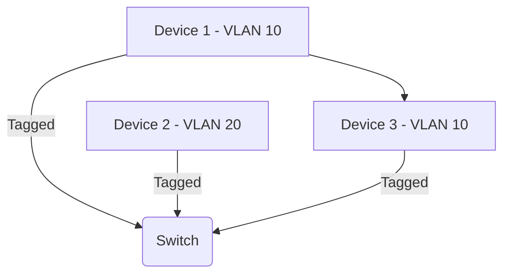

# Virtual LANs (VLANs): Network Segmentation 101

*Part 15 of the [networking and home lab series](2025-04-25-networking-and-home-lab-series.md).*

Ever found yourself buried under a pile of network cables, wondering if there's an easier way to manage your growing home network or small business setup? Well, you're in luck. Virtual LANs (VLANs) are like the Swiss Army knife for network segmentation, allowing you to slice and dice your network logically without splurging on extra hardware. This post will walk you through the basics of VLANs, why they matter, and how you can deploy them effectively in both home and business environments.

<!-- more -->

## What Are VLANs?

### Why Segment Networks?

Think of a network as a football pitch. Without any lines, it's chaos—players running everywhere with no structure. VLANs are like drawing those white chalk lines, creating logical boundaries so each team knows its space and role.

- **Organisation**: By segmenting networks, you can organise devices into logical groups.
- **Security**: Reduce the risk of sensitive data being intercepted by isolating different types of traffic.
- **Efficiency**: Limit broadcast traffic to specific segments, improving overall network performance.

## VLAN Basics

### Logical Separation of Networks

VLANs allow you to create separate networks on the same physical switch. Instead of buying multiple switches to segment traffic physically, VLANs do it logically.

- **VLAN IDs and Tagging**: Each VLAN is assigned an ID (a number) that is used to tag packets. This tagging ensures that data travels only within its designated virtual lane.
- **Broadcast Domains**: A VLAN confines broadcast traffic to its own domain, preventing unnecessary data from bogging down other parts of the network.

## VLAN Types

### Port-based VLANs

This method assigns specific switch ports to a VLAN. Simple but less flexible if devices move around frequently.

- **Static association**: Ports are manually assigned.
- **Usage**: Best in environments where devices rarely change locations.

### Tag-based VLANs

Also known as IEEE 802.1Q, this is more dynamic. Tags are added to Ethernet frames to identify which VLAN they belong to.

- **Dynamic association**: Easier to manage when devices need to move between ports.
- **Common use case**: Ideal for larger environments where flexibility is key.

## VLAN Configuration

### Managed Switches

To set up VLANs, you'll need managed switches capable of handling tagging.

- **Configuration Access**: Often done via a web interface or command line.
- **Flexibility**: Allows for complex setups and fine-tuning of network policies.

### Trunk Ports

Trunk ports carry traffic for multiple VLANs over a single physical link. Imagine them as motorways for your network packets.

- **Tagging Required**: Tags ensure packets reach their correct destination.
- **Use Case**: Essential for connecting multiple switches or integrating with routers.

### Access Ports

Access ports connect end devices to the switch and belong to a single VLAN. Think of these as side streets leading off the motorway (trunk port).

- **Untagged Traffic**: Only carry untagged traffic specific to their assigned VLAN.
- **Best Practice**: Use for endpoint connections like computers or printers.

## Home and Small Business Use Cases

VLANs aren't just for big corporate data centres. They're handy in homes and small offices too!

### Guest Networks

Create a separate guest network so your visitors can't access your main devices. It's like giving guests their own room without keys to the rest of your house.

### IoT Device Isolation

Keep your smart fridge from chatting up your work computer by isolating IoT devices on their own VLAN.

### Network Segmentation for Security

Separate critical business systems from general employee access networks, akin to having a locked filing cabinet for sensitive documents.

### Example - Using VLANs on an Asus Router

Some home routers offer basic VLAN support:

1. Log into the router's admin panel.
2. Navigate to the "LAN" settings.
3. Configure different ports with unique VLAN IDs.
4. Ensure trunking is enabled if connecting additional switches.

## Benefits of VLANs

Why go through all this effort? Here’s why:

### Security

By isolating sensitive parts of your network, you minimise potential attack vectors—like keeping valuable livestock fenced away from roaming predators.

### Performance

Limiting broadcast domains means less traffic congestion, akin to reducing rush-hour jams by adding more lanes on a road.

### Management

Logical segmentation simplifies administration tasks—from troubleshooting issues to applying policies—just like managing smaller fields rather than one massive plot of land.

## Conclusion

In summary, VLANs offer a powerful tool for organising and optimising networks both at home and in small businesses. They provide enhanced security, improved performance, and simpler management without requiring additional physical infrastructure. So next time you're faced with tangled cables and sluggish connections, consider deploying VLANs—it might just be the solution you're looking for!

---

> **Takeaway**: Think of VLANs as logical fences within your digital landscape—providing structure, security, and efficiency without needing more hardware cluttering up your space. Whether it's enhancing security or boosting performance, they're an indispensable part of modern networking strategy.
