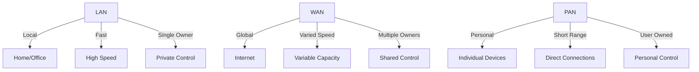

# What Is a Network? (LAN, WAN, PAN Explained Simply)

*Part 1 of the [networking and home lab series](2025-04-25-networking-and-home-lab-series.md).*

Pull up a chair, grab a brew, and let's have a chat about something that's basically the backbone of our modern world: networks. No, not the social media kind; I'm talking about the unseen web of connections that lets your computer talk to your printer, or your phone stream football results without missing a beat.

<!-- more -->

## What Is a Network? (Layman's Terms)

Think of a network like a good old-fashioned postal system. You've got different post offices (devices) sending letters (data) along various routes (connections) to reach their destination. Simple enough, right?

## Why Are Networks Important in Daily Life?

Networks are the unsung heroes in our daily lives. They:

- **Connect us**: Whether you're video calling your nan or emailing your boss.
- **Entertain us**: Streaming the latest series or playing games online.
- **Enable work**: From accessing company servers to collaborating with colleagues.
- **Automate homes**: With smart devices and IoT gadgets making life easier.

Now, let's break down the different types of networks you'll come across in both home and office environments.

## LAN (Local Area Network)

### Definition and Characteristics

A **Local Area Network (LAN)** is like a small village — everything's close by. It's a network covering a limited area such as a home, school, or office building.

- **Geographical scope**: Limited to a single location.
- **Speed**: Typically faster due to short distances.
- **Ownership**: Usually owned and managed by a single organisation or individual.

### Home Network Examples

In most homes, a LAN is set up using:

- **Router**: Acts like the village post office, directing traffic between devices.
- **Devices**: Computers, smartphones, tablets, smart TVs all connected to the router.
- **Wired/Wireless connections**: Ethernet cables for stability or Wi-Fi for convenience.

### Small Office LAN Scenarios

Imagine an office where:

- Printers are shared across multiple computers.
- Files are stored on a central server accessible by everyone.
- Employees connect their laptops both wirelessly and through docking stations.

Here, everything operates within this local network bubble.

## WAN (Wide Area Network)

### Definition and Scale

A **Wide Area Network (WAN)** is more like an entire country with cities and towns connected over long distances. It uses telecommunications links for its connections.

- **Geographical scope**: Spans large distances, even globally.
- **Speed**: Generally slower due to distance but has high capacity.
- **Ownership**: May involve multiple organisations.

### Internet as the Largest WAN

The Internet itself is the ultimate WAN — it's basically every network in the world talking to each other. Your home LAN connects to it via your Internet Service Provider (ISP).

### Connecting Remote Offices

For businesses with multiple locations:

- A WAN can link these remote offices into one cohesive network.
- Often involves leased lines or VPNs for secure communication.

## PAN (Personal Area Network)

### Definition and Short-range Focus

A **Personal Area Network (PAN)** is like your personal bubble — just you and your immediate space. It covers very short distances — think centimetres to metres.

- **Geographical scope**: Very limited range around an individual.
- **Speed**: Fast due to proximity but limited by technology used.
- **Ownership**: Personal and typically managed by the user.

### Bluetooth Examples

Bluetooth creates PANs with devices like:

- Headphones paired with your smartphone.
- Wireless keyboards connected to your computer.

### Wi-Fi Direct

Wi-Fi Direct lets devices communicate directly without needing a router — handy for quick file transfers between phones or connecting printers without cables.

## Comparison Table (LAN, WAN, PAN)

Here's how these networks stack up against each other:

## Conclusion

### Recap of Network Types

To sum it all up:

- **LANs** are your local networks at home or office — fast and private.
- **WANs** stretch across countries or continents — slower but vast.
- **PANs** are intimate setups around you — personal and direct.

### Importance of Understanding Networks

Understanding these basics helps demystify how your devices connect and interact. It's not just geeky trivia; it's about knowing the tech that keeps us all connected in our ever-digital world. So next time you hit "send" on an email or stream that new show, you'll know exactly what goes on behind the scenes. Cheers!
