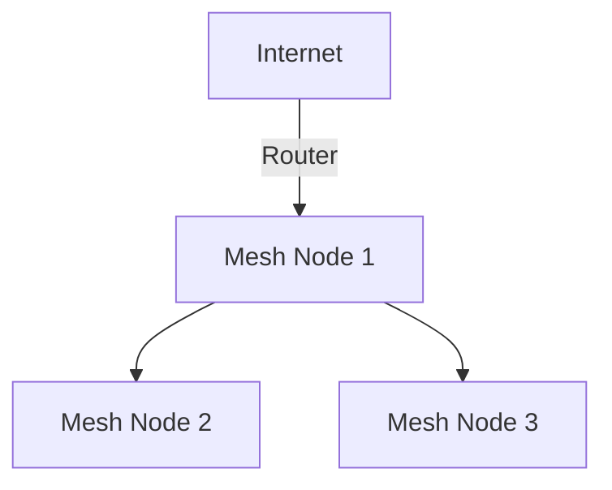

# Wired vs Wireless: Ethernet and Wi-Fi Compared

*Part 4 of the [networking and home lab series](2025-04-25-networking-and-home-lab-series.md).*

## Introduction

Ah, network connectivity—a bit like the plumbing in your house. You don't really think about it until something goes wrong, but when it does, you're knee-deep in water (or in this case, connection issues). Whether you’re binge-watching the latest series on Netflix or working from home, a solid network is crucial. In this post, we'll have a natter about two common networking options: **Ethernet** and **Wi-Fi**.

<!-- more -->

We’ll explore the ins and outs of these technologies, looking at their pros and cons, suitable use-cases, and how to choose between them for your specific needs. Spoiler alert: there’s no one-size-fits-all answer, just like there’s no one brew that suits everyone. So let’s dive in.

## Ethernet

### Cabling Standards

The backbone of wired networks is made up of cables—no surprises there. Let’s break down the common ones:

- **Cat5e**: Supports gigabit speeds (up to 1 Gbps) over short distances. It's like your reliable old workhorse tractor; nothing fancy but gets the job done.
- **Cat6**: Handles up to 10 Gbps over 55 metres. It's faster than Cat5e, akin to upgrading from a regular drill to an impact driver.
- **Cat6a**: This one can stretch 10 Gbps speeds over the full 100 metres. Think of it as a sports car—fast and capable.
- **Cat7/Cat8**: More suited for data centres with very high speeds and shielding to reduce interference. These are your Formula 1 cars.

### Speeds and Bandwidth

Ethernet generally offers higher and more consistent speeds than Wi-Fi:

- Steady speeds up to 1 Gbps or more
- Minimal latency—great for gaming or VoIP calls
- Less prone to interference from other devices

### Reliability and Stability

In terms of reliability, Ethernet is like that mate who always turns up on time—dependable:

- Consistent performance unaffected by physical obstacles
- Ideal for environments where stability is key (like offices or server rooms)

### Use Cases

Ethernet shines in scenarios where reliability is non-negotiable:

- **Desktops**: For those who need uninterrupted internet access.
- **Servers**: Data centres rely heavily on wired connections.
- **Gaming Consoles**: Keeps latency low for that competitive edge.

## Wi-Fi

### Wi-Fi Standards

Wi-Fi has its own bunch of standards. It’s like football leagues; different levels for different needs:

- **802.11a/b/g/n/ac/ax (Wi-Fi 6)**: The alphabets represent various versions with increasing speed and efficiency.
- Wi-Fi 6 (802.11ax) is the latest, offering better performance in crowded environments—like playing five-a-side on a crowded pitch.

### Frequency Bands

Wi-Fi operates over two primary frequency bands:

- **2.4 GHz**: Longer range but lower speed, akin to a long-distance runner.
- **5 GHz**: Faster but shorter range—think of it as a sprinter.

### Range and Obstacles

Wi-Fi signals are like sound waves—they get blocked by walls and furniture:

- Range varies based on obstacles; open spaces are ideal
- Walls, metal objects, and even fish tanks can cause signal degradation

### Interference and Security

Wi-Fi isn't immune to interference:

- Competes with other wireless devices (microwaves, Bluetooth)
- Security is paramount; always use WPA3 if possible to avoid being the open goal of cyber threats.

### Wi-Fi Mesh Networks

A modern solution for large homes or complex layouts:

Mesh networks spread coverage evenly across an area, reducing dead zones. It’s like having multiple midfielders covering every inch of the pitch.

## Comparison

Here's how Ethernet and Wi-Fi stack up against each other:

| Feature       | Ethernet                | Wi-Fi                     |
|---------------|-------------------------|---------------------------|
| Speed         | Up to 10 Gbps           | Up to 9.6 Gbps (Wi-Fi 6)  |
| Reliability   | High                    | Variable                  |
| Cost          | Generally cheaper       | Equipment can be pricey   |
| Mobility      | Limited (tethered)      | Excellent                 |

## Choosing the Right Technology

Deciding between Ethernet and Wi-Fi depends largely on your environment and requirements:

### Home Scenarios

For a typical home setup:

- **Use Ethernet** if you have devices that stay in one place—like desktop PCs or smart TVs.
- **Opt for Wi-Fi** if you need flexibility—tablets, smartphones, or laptops moving around the house.

### Office Scenarios

In an office setting:

- A hybrid approach often works best:
  - **Ethernet** for stationary equipment such as PCs and printers.
  - **Wi-Fi** for mobile devices or areas where cabling isn’t feasible.

## Conclusion

The world of connectivity is ever-evolving. Much like how VAR has changed football strategies (for better or worse), new developments in networking technology continuously alter our approach to home and office setups.

Ultimately, both Ethernet and Wi-Fi have their place in our digital lives; understanding your specific needs will help you make the best choice. Whether it’s the steadfast reliability of Ethernet or the flexible convenience of Wi-Fi—or indeed a combination of both—there’s a solution that fits every scenario.

## Key Takeaways

- Ethernet offers unmatched reliability and speed; it's perfect if stability is essential.
- Wi-Fi provides flexibility and ease of installation but can suffer from interference.
- Consider your specific use-case: stationary vs. mobile devices.
- A hybrid approach often yields the best results in mixed environments.

In the end, it all comes down to what fits your needs best—and remember, just like tea preferences, it's all about personal taste!
