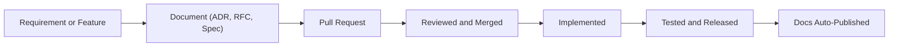

# Docs as Code: What It Is, Who It’s For, and When It Works Best

Documentation has long been the unloved sidekick of software engineering. Too often it’s either non-existent, buried in disconnected tools, or hopelessly out of date. And yet, in every retrospective, someone inevitably says, “We really need to improve our documentation.”

<!-- more -->

The problem isn’t just a lack of effort — it’s a mismatch of tools, processes, and expectations. What if we could make documentation a first-class citizen in the engineering process? What if it lived alongside code, evolved with it, and was reviewed, versioned, and deployed just like our software?

That’s the promise of **Docs as Code**.

In this post, we’ll define what Docs-as-Code means and who it’s for. Then we’ll look at where it excels, where it falls short, and how to make it work in the real world.

---

## What Is Docs-as-Code?

**Docs-as-Code** is the practice of treating documentation like source code. This means:

- Writing in plain text formats like Markdown or reStructuredText
- Storing documentation in version control systems (e.g. Git)
- Reviewing changes via pull requests
- Publishing documentation using automated CI/CD pipelines
- Keeping docs close to the systems they describe

But more than that, it’s a mindset shift. It says: documentation is an engineering artefact, not a delivery afterthought. It deserves structure, traceability, and review just like the systems it supports.

### Key Principles

- **Versioned** – Documentation changes are tracked with history and context
- **Collaborative** – Anyone can review, propose, or refine docs
- **Automated** – Publishing, formatting, and verification are handled in CI/CD
- **Accessible** – Docs are plain-text, editor-agnostic, and portable
- **Integrated** – Docs are updated as part of feature or architecture work

Docs-as-Code fits naturally into engineering workflows, making it easier to write just enough documentation, just in time.

---

## Why Docs-as-Code Matters

In modern software delivery, the pace of change is fast and the complexity high. Whether you're building embedded systems, APIs, web apps, or cloud-native platforms, there's always architectural rationale, interface contracts, or operational constraints to capture.

But traditional documentation tools — Word docs, PowerPoints, Confluence wikis — often work against us. They live outside the developer workflow, lack versioning, and fall out of sync quickly.

With Docs-as-Code, documentation:

- Lives in the same repo (or adjacent one) as the code
- Is updated as part of development, not after
- Can be linted, validated, and reviewed like source code
- Evolves alongside the product lifecycle

Imagine being able to track the rationale behind a decision, see the exact change that prompted it, and trace its impact across systems. Docs-as-Code makes that not only possible, but normal.

---

## When Docs-as-Code Works Best

Docs-as-Code is a strong fit for teams who:

- Use Git or similar version control systems daily
- Maintain systems that are long-lived or regulated
- Need to capture architectural decisions, interface definitions, and integration points
- Have technical contributors (engineers, architects) who are comfortable editing Markdown
- Want to automate publishing, validation, and formatting of their docs

It works well for artefacts such as:

- Architecture Decision Records (ADRs)
- System overviews and integration diagrams
- Technical proposals (RFCs)
- Interface specifications (API, hardware, data)
- Operational runbooks and test strategies

...

---

## When It Doesn’t Work (and That’s Okay)

Docs-as-Code isn’t a silver bullet. It's not ideal when:

- Non-technical contributors (e.g. business analysts, execs) need to co-author or comment directly
- Real-time collaboration is essential (e.g. workshops, brainstorming)
- Documentation must follow rigid Word-based templates (common in legal, safety, or compliance contexts)
- The team lacks Git fluency or resists text-based workflows

In such cases, a hybrid approach may be better: use Docs-as-Code for technical artefacts, and connect them to Word or SharePoint docs where needed.

📌 **Tip**: Even if you can't abandon SharePoint or Confluence, you can often **generate** Word or PDF artefacts from markdown using tools like Pandoc or MkDocs plugins.

---

## Diagrams Are Part of the Story, Not the Story Itself

I’m a firm believer that diagrams are essential for clarity. But they’re **supporting content**, not standalone artefacts. They belong inside the documents they relate to — not floating in a diagrams folder.

Types of diagrams I use in Docs-as-Code:

- C4 diagrams for system and container views
- Sequence diagrams for protocol flows
- BPMN for business processes
- Deployment and timing diagrams
- Data flow diagrams, state machines, and ERDs

---

## Tooling That Works

You don’t need a massive toolchain to start. Here's what I actually use:

- **Markdown** – with YAML frontmatter for metadata.
- **MkDocs + Material** – my go-to for internal documentation portals.
- **Mermaid or Structurizr DSL** – for diagrams that live in version control.
- **GitHub Actions** – build, test, and deploy docs as part of CI.
- **markdownlint + link checkers** – avoid bit rot and bad links.

This stack works for firmware, applications, system-level integration, and customer-specific overlays. It scales.

---

## Common Mistakes I’ve Made (So You Don’t Have To)

1. **Over-structuring too early**  
   Don’t build a cathedral of folders on day one. Let the structure evolve as content grows.

2. **Not training non-devs**  
   Teach product managers and QA to use docs-as-code — or let them contribute via pull requests without fear.

3. **Treating diagrams as artefacts**  
   A diagram without text is noise. Context is everything. Embed diagrams in the documents they belong to.

4. **Skipping reviews**  
   Docs should be reviewed just like code. No review? No merge.

5. **Letting them rot**  
   Put ownership and review dates in frontmatter. Schedule doc reviews alongside sprint planning or release prep.

---

## Getting Started in a Real Team

Here’s how I introduce this to teams without resistance:

- Start with **ADRs** in Markdown. Use a simple template.
- Publish via **MkDocs** or similar. Show value quickly.
- Encourage updates through PRs. Keep the bar low.
- Add RFCs for cross-team proposals.
- Build a **docs CI pipeline** — and make it visible.

It’s better to start with one useful, maintained artefact than a dozen dead ones. Build momentum, not debt.

---

## Final Thoughts

Docs-as-Code isn’t about writing more. It’s about writing better — in a way that’s durable, discoverable, and integrated with engineering.

It turns documentation into an active part of delivery. It brings traceability to decisions. And it helps your architecture live beyond the current sprint.

It’s changed how I lead, how I deliver, and how I onboard teams.

If that sounds useful to you — start with one doc, one folder, one pull request.

You won’t look back.

---

📘 Next in the series: [Writing for Systems, Products, and Projects – Scoping Documentation the Right Way](2025-05-13-scoping-docs.md)
