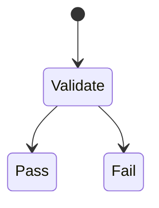
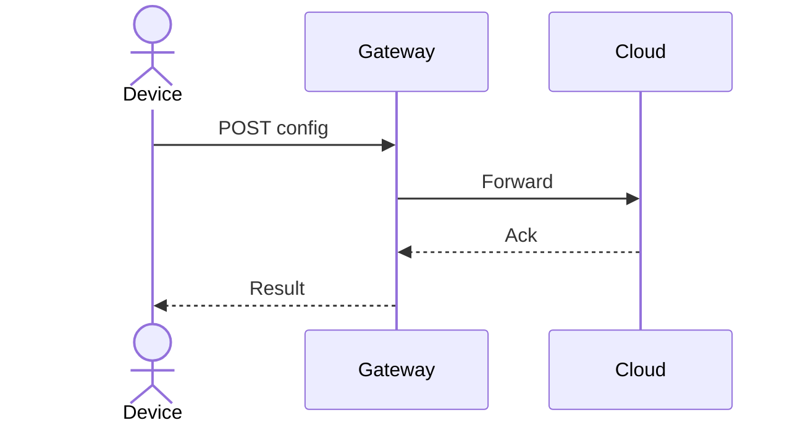
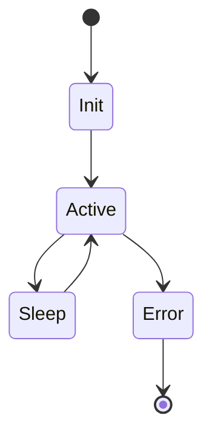
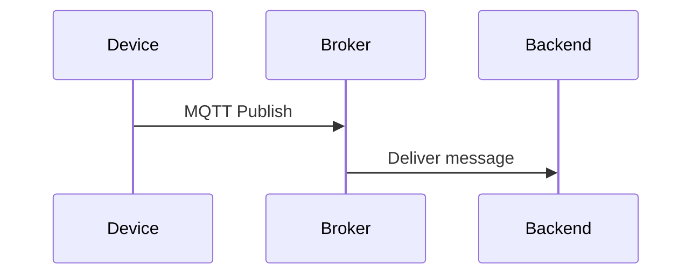

# Going Beyond Markdown: Rich, Interactive, and Cross-linked Docs

Markdown has become the lingua franca of technical documentation — and with good reason. It's lightweight, portable, and readable in its raw form. But for engineering teams building large, interrelated systems, plain Markdown often isn't enough.

<!-- more -->

What you need is more than a README. You need a browsable, interactive, and **cross-linked knowledge system** that works like code: versioned, tagged, and inspectable.

In this post, we’ll explore how to make your documentation smarter and more maintainable by going **beyond Markdown**. You’ll learn how to:

- Use YAML frontmatter for ownership, lifecycle, tagging, and indexing
- Add tabs, collapsible sections, filters, and reusable components
- Embed diagrams (sequence, state, data flow, C4) inline with docs
- Link artefacts together — RFCs, ADRs, test strategies, diagrams
- Build structured, discoverable engineering knowledge

Let’s start by making our Markdown smarter.

---

## YAML Frontmatter: Metadata for Docs-as-Code

Frontmatter is metadata embedded at the top of a Markdown file. It can be used to encode:

- Ownership
- Component scope
- Status and lifecycle
- Review cycle
- Tags for filtering and searching

### Example

```yaml
title: "ADR-014: Migrate to JSON Schema"
owner: "platform-team"
component: "config-service"
status: "active"
last-reviewed: "2025-02-01"
next-review: "2026-02-01"
tags: ["adr", "validation", "schema", "json"]
```

This enables:

- Filtering and navigation in static sites (MkDocs, Docusaurus)
- CI linting and stale-doc detection
- Dashboards for review cycles and ownership

---

## Tabs, Collapsible Sections, and Shortcodes

Static site generators support rich layouts that improve readability without bloating your docs.

### Tabs (MkDocs with Material Theme)

```markdown
=== "Option A – JSON"
    Use simple human-readable formats.

=== "Option B – Protobuf"
    Use efficient binary encoding.
```

### Collapsible Sections

```markdown
??? note "Why we deprecated CoAP"
    CoAP lacked TLS support and had poor observability.
```

### Reusable Shortcodes

Define a template for callouts or blocks and reuse across pages. In MkDocs:

```yaml
macros:
  variables:
    owner: "Platform Team"
```

Then in your Markdown:

```markdown
!!! info "Owned by {{ owner }}"
```

📌 Improves consistency and keeps docs DRY.

---

## Cross-linking Artefacts

Documentation isn’t standalone — it’s a network of decisions, specs, and views.

Link between:

- ADRs and RFCs
- Diagrams and the specs they support
- Features and the artefacts that implement them
- Diagrams and test cases

### Example

````markdown
## Protocol Decision

See [ADR-014](../adr/014-json-schema.md) for rationale.

The [test strategy](../tests/schema-tests.md) covers validation edge cases.


````

### Make use of backlinks

At the bottom of each ADR:

```markdown
**Referenced by**:
- [RFC-011: Config Protocol Rework](../rfc/011-config.md)
- [Validation Tests](../tests/schema.md)
```

---

## Embedded Diagrams: Inline, Not Siloed

A diagram should never be standalone. It should live **inside the document it explains**.

### Mermaid for Sequence



### State Diagrams for Firmware



### Structurizr DSL

```dsl
container config-service {
    technology "Go"
    description "Validates and stores configuration"
}
```

📌 Keep diagram sources (`.mmd`, `.dsl`) in version control.

---

## Folder Structure for Interactive Docs

```plaintext
docs/
├── index.md
├── adr/
│   └── 014-json-schema.md
├── rfc/
│   └── 011-config-proposal.md
├── specs/
│   └── mqtt-schema.md
├── tests/
│   └── schema-validation.md
├── diagrams/
│   ├── device-flow.mmd
│   └── system-context.dsl
├── components/
│   └── config-service.md
```

Every folder should include:
- `index.md` or metadata
- Cross-links to related artefacts
- Embedded diagrams

---

## Filters, Search, and Navigation

Static site generators allow rich navigation powered by metadata.

### Example

- Filter ADRs by component
- Search all test specs tagged with `validation`
- List all artefacts owned by `platform-team`

Use tags and component fields to build custom views:

```yaml
tags: ["adr", "device-ingestion"]
component: "device-gateway"
```

---

## Sample Interactive Artefact: An ADR

````markdown
---
title: "ADR-015: Use MQTT v3.1.1 for Field Comms"
owner: "firmware-team"
component: "field-device"
status: "active"
tags: ["mqtt", "communication", "protocol"]
---

## Decision

Use MQTT over TLS for field-to-cloud communication.

## Rationale

- Lightweight
- Supports pub/sub
- Supported by infrastructure partner

## Diagram



## Related

- [RFC-008: Messaging Protocol Options](../rfc/008-protocol.md)
- [Test Strategy](../tests/mqtt-delivery.md)
````

---

## Final Thoughts

Markdown is a brilliant starting point. But when you enrich it with metadata, diagrams, structure, and links — it becomes a documentation system.

You don’t need Confluence or a CMS. You need:

- Frontmatter metadata for traceability
- Embedded diagrams for clarity
- Tabs and collapsibles for UX
- Links between artefacts for continuity
- A build pipeline for trust and visibility

Write like you code. Structure like you model. And publish like it matters.

---

📘 Next in the series: [Docs-as-Code Smells and Anti-Patterns](2025-05-15-docs-as-code-smells.md)
