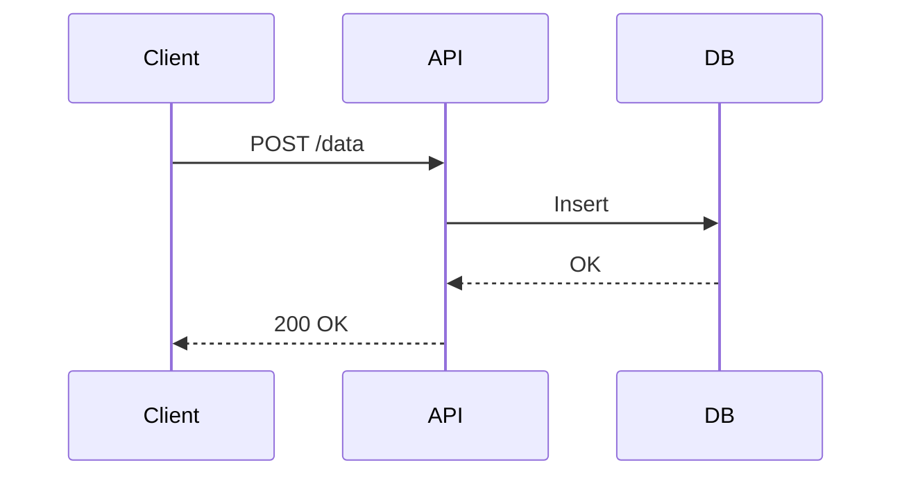

# Docs-as-Code Smells and Anti-Patterns

Docs-as-Code done well can transform documentation from a last-minute task into an essential, integrated part of your engineering system. But when done badly — or worse, indifferently — it introduces a new layer of confusion, drift, and friction.

<!-- more -->

This post explores the most common smells and anti-patterns that creep into Docs-as-Code efforts. Based on real experience from running embedded and cloud-based teams, these are the patterns that undermine trust, slow onboarding, and create technical debt in narrative form.

We'll also look at how to identify, fix, and avoid them — and how to instil a culture where documentation stays alive.

---

## Smell 1: Unowned and Unreviewed Documentation

### What It Looks Like

- No frontmatter with `owner:` or `last-reviewed:` metadata
- Docs that were useful once but haven’t been touched in years
- Questions like “Is this still relevant?” met with “...probably?”

### Real Impact

Without ownership, documentation decays into folklore. New starters can’t trust it, seniors don’t want to maintain it, and audits become guesswork.

### Fix It

- Add frontmatter like:
```yaml
owner: "architecture-team"
last-reviewed: "2025-01-01"
next-review: "2026-01-01"
```
- Schedule automated reminders in GitHub Actions or Azure DevOps
- Create dashboards of “docs due for review” per team

---

## Smell 2: Boilerplate Overload

### What It Looks Like

- Pages explaining what HTTP is, or how REST works
- Documents bloated with templated sections no one fills in
- “Design Docs” that are mostly copied and pasted text

### Real Impact

It makes documentation hard to maintain, hard to read, and discourages contribution. Meanwhile, actual design decisions go undocumented.

### Fix It

- Create short Markdown templates with clear section purposes
- Move boilerplate to collapsible callouts or footnotes
- Focus on documenting **what’s specific**, not **what’s obvious**

---

## Smell 3: Tool Sprawl

### What It Looks Like

- One team uses Markdown, another Confluence, another Google Docs
- Diagrams in Visio, Draw.io, and Lucidchart — all detached from version control
- PDFs emailed before releases

### Real Impact

You lose traceability, version history, and the ability to review as part of CI/CD. No one knows where the truth is.

### Fix It

- Define a single source of truth (usually Markdown in Git)
- Export only where needed (e.g., PDFs from markdown using Pandoc)
- Use version-controlled diagram formats (Mermaid, PlantUML, Structurizr DSL)

---

## Smell 4: Diagrams That Don’t Match Reality

### What It Looks Like

- System diagrams created in early design phase, never updated
- Diagrams that contradict the text
- No `.mmd` or `.puml` source — just static images

### Real Impact

New team members get the wrong idea. Diagrams lose trust. Architecture reviews are based on old assumptions.

### Fix It

- Create diagrams as code:

- Store alongside the document it supports
- Add diagram diffs to PR reviews

---

## Smell 5: Docs Updated Separately from Code

### What It Looks Like

- Feature implemented, but related ADR isn’t updated
- Interface changes, but no update to spec or diagram
- `TODO: document later` left in Markdown

### Real Impact

The longer the gap, the harder it is to go back. Docs lag, and soon nobody trusts them.

### Fix It

- Add documentation changes as part of the Definition of Done
- Use PR templates to ask:

```markdown
- [ ] Have diagrams been updated?
- [ ] Have related ADRs or specs been linked?
```

---

## Smell 6: Docs Without Traceability

### What It Looks Like

- No way to connect docs to the epics, features, or tests they support
- ADRs don’t link to the code they impact
- Feature specs with no linked test strategy

### Real Impact

Hard to answer: “Is this feature tested?”, “Which doc supports this decision?”, “What code changed?”

### Fix It

- Use frontmatter fields:
```yaml
linked-feature: "FEAT-122"
linked-adr: "adr-014-mqtt-choice"
linked-tests: ["test-id-239", "test-id-241"]
```
- Auto-generate traceability tables
- Use folders structured by component or domain

---

## Smell 7: Docs Written for Review, Not Reuse

### What It Looks Like

- Documents crafted to impress stakeholders
- Shiny PDF-style formatting with no version control
- Lacking detail for engineers who’ll use or extend it

### Real Impact

Looks great on demo day. Useless the following week.

### Fix It

- Optimise for readers doing real work
- Focus on: why, how, what could break
- Treat diagrams, specs, and ADRs as working tools, not handover artefacts

---

## Smell Review Checklist

| Smell                           | Symptom                                              | Fix Summary                      |
|--------------------------------|-------------------------------------------------------|----------------------------------|
| Unowned Docs                   | No frontmatter, no review plan                       | Add owner, review metadata       |
| Boilerplate Overload           | Long docs, few insights                             | Shrink templates, prioritise why |
| Tool Sprawl                    | Docs split across platforms                         | Consolidate, export not author   |
| Static Diagrams                | Outdated PNGs, unlinked diagrams                    | Use diagrams-as-code             |
| Docs not updated with code     | Mismatched diagrams, missing context                | Add doc checks to PR process     |
| Poor traceability              | Unlinked ADRs, tests, specs                         | Add frontmatter linking          |
| One-time-use docs              | Shiny for signoff, no reuse                         | Write for real-world consumers   |

---

## Real-World Anecdotes

### The Case of the Duplicate Specs

One project had 3 specs describing the same integration — one in Word, one in Confluence, one in Git. None matched. A delivery was blocked for 2 weeks as teams tried to resolve what the “real” data format was. We deleted the other two and mandated version-controlled Markdown with a diagram rendered from source.

### The Forgotten Diagram

A field service integration looked sound… until one dev noticed the data never passed through the gateway shown in the “validated” architecture PNG. It hadn’t been updated in 18 months.

---

## Culture Fixes

- Treat docs as part of your delivery asset
- Include documentation in sprint review and retros
- Run periodic doc health checks
- Visualise doc ownership in dashboards
- Rotate documentation champions per team

---

## Suggested CI Enhancements

- Validate YAML frontmatter (owner, status, review dates)
- Lint Markdown with `markdownlint`
- Spell check and broken link check
- Warn if `last-reviewed` is older than X months
- Auto-generate dashboards from metadata

---

## Recommended Folder Structure

```plaintext
docs/
├── adr/
│   ├── 001-initial.md
│   └── 014-mqtt-choice.md
├── rfc/
│   └── 009-new-data-model.md
├── diagrams/
│   ├── mqtt-sequence.mmd
├── interfaces/
│   └── mqtt-format.md
├── tests/
│   └── telemetry-schema.md
├── retired/
│   └── old-gateway-design.md
└── OWNERS.md
```

---

## Final Thoughts

Docs-as-Code can bring engineering discipline to documentation — but it’s easy to fall into the trap of process without purpose. Most of these smells are easy to spot once you know what to look for, and most fixes are cultural rather than technical.

Start with ownership. Add structure. Build review habits. And always link documents to the system they describe — so they stay alive, useful, and used.

---

📘 Next in the series: [Case Study: Multi-Layer Docs-as-Code in Practice](2025-05-15-docs-as-code-case-study.md)
