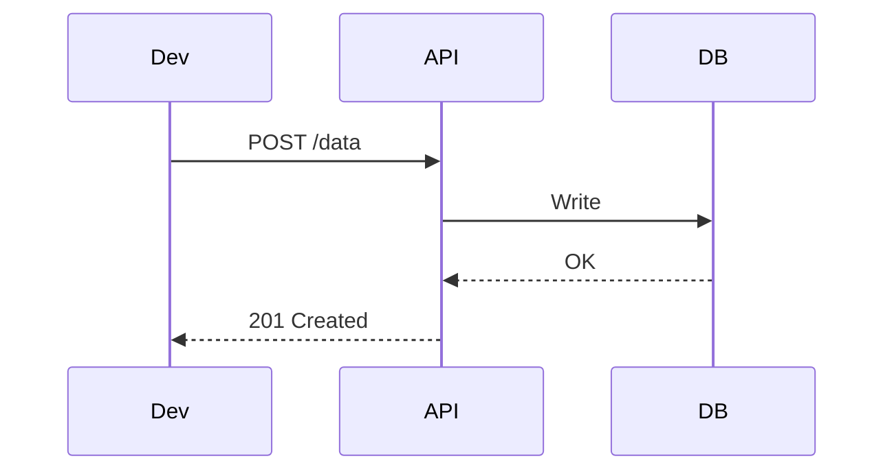
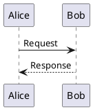

# Tools of the Trade: Building a Docs-as-Code Stack That Works

You can’t adopt Docs-as-Code without tooling. But tooling can also kill your adoption if it’s too complex, too brittle, or too much of a jump from where your team is today.

<!-- more -->

Over the years I’ve seen every kind of setup. Markdown in Dropbox, Confluence migrations into Git, over-engineered pipelines no one maintains, and hand-cranked PDFs for safety-critical handovers. Some worked. Many didn’t.

This post covers the essential tooling for building a Docs-as-Code workflow that works across teams — from firmware and platform devs to tech leads and ops. It’s focused on practicality, automation, and team adoption.

## Static Site Generators

Static site generators turn Markdown into a browsable, searchable website — the fastest route to making docs visible and usable.

### MkDocs (Material Theme)

The sweet spot for internal engineering teams. It’s fast, Markdown-native, and incredibly extensible.

```bash
pip install mkdocs-material
mkdocs new my-docs
cd my-docs
mkdocs serve
```

**Pros**:
- Instant local preview
- Built-in search
- Mermaid + admonition support
- Well-documented plugin ecosystem

**Common plugins**:
- `macros` for templated docs
- `glightbox` for lightbox images
- `awesome-pages` for nav config via file structure

**Great for**: Architecture docs, engineering handbooks, platform knowledge.

### Docusaurus

If your teams are React-fluent or you need versioning and i18n, Docusaurus is worth a look.

```bash
npx create-docusaurus@latest my-site classic
npm run start
```

**Pros**:
- React-based
- Handles multi-language content
- SEO-friendly

**Watch out for**:
- Slightly higher setup curve
- Overhead if you’re not writing React-heavy content

### Hugo

Super-fast Go-based generator. Great for blog-like sites and fast page builds.

**Pros**:
- Very performant
- Strong theme ecosystem

**Cons**:
- Not Markdown-purist friendly (requires frontmatter gymnastics)
- Steeper learning curve for theming

---

## Diagrams as Code

Forget Visio screenshots. Diagrams-as-Code gives you versionable, embeddable, testable diagrams.

### Mermaid

Markdown-native, integrates perfectly with MkDocs and Docusaurus.



**Supports**: Sequence, flowcharts, state, Gantt, pie charts.

**Limitations**: Less control over layout, no conditional rendering logic.

### PlantUML

Richer syntax and broader diagram support. Used heavily in enterprise architecture.



**Supports**: Component, deployment, class, activity diagrams.

**Integrates with**: CI tools, CLI exporters, online servers.

### Structurizr DSL

Designed for software architects. Implements the C4 model in code.

```plaintext
workspace {

  model {
    user = person "User"
    app = softwareSystem "App"
    user -> app "Uses"
  }

  views {
    systemContext app {
      include *
      autolayout
    }
  }
}
```

**Supports**: Context, Container, Component views. DSL hosted or local.

---

## Linters and Spellchecking

### markdownlint

Catch formatting issues automatically.

```bash
npm install -g markdownlint-cli
markdownlint docs/
```

Add this to pre-commit hooks or GitHub Actions for PR enforcement.

### cspell

Markdown-aware spell checker with support for project-specific dictionaries.

```bash
cspell "**/*.md"
```

Add ignored terms like protocol names or field IDs to `cspell.json`.

### markdown-link-check

Catches broken internal and external links.

```bash
npx markdown-link-check README.md
```

---

## Preview Pipelines and CI

If docs aren’t easy to preview, no one will review them.

### GitHub Actions (MkDocs)

```yaml
name: Build & Preview Docs

on:
  pull_request:

jobs:
  build:
    runs-on: ubuntu-latest
    steps:
      - uses: actions/checkout@v3
      - uses: actions/setup-python@v4
        with:
          python-version: '3.x'
      - run: pip install mkdocs-material
      - run: mkdocs build
```

**Options**:
- Publish to GitHub Pages
- Deploy to Netlify/Vercel for shareable PR previews
- Comment rendered URLs back into PRs

---

## Portable Outputs (for Word/PDF/SharePoint)

Some teams (especially in regulated domains) need deliverables in .docx or PDF.

### Pandoc

The Swiss Army knife of document conversion.

```bash
pandoc design.md -o design.docx
```

Use templates to match corporate branding, insert headers/footers, watermark drafts.

### md-to-pdf

Simple CLI for converting to styled PDFs.

```bash
npx md-to-pdf docs/overview.md
```

Useful for producing release handover packs, onboarding kits, or delivery bundles.

---

## Folder Structure Best Practice

```plaintext
docs/
├── index.md
├── adr/
│   ├── 0001-select-database.md
│   └── 0002-logging-structure.md
├── rfc/
│   └── 0001-protocol-options.md
├── diagrams/
│   ├── system-context.dsl
│   └── retry-logic.puml
├── canvases/
│   ├── inception-sync-service.md
├── checklists/
│   └── release-prep.md
├── tests/
│   └── traceability-matrix.md
└── output/
    ├── release-pack-v1.docx
```

- **Markdown-first** by default
- **Diagram source stored alongside Markdown**
- **Output folder** holds PDF/Word exports for sharing
- **Traceability files** link features → artefacts → tests

---

## Tooling Comparison Summary

| Tool           | Purpose                 | Strengths                         | Docs-as-Code Fit |
|----------------|--------------------------|-----------------------------------|------------------|
| MkDocs         | Site generation          | Lightweight, fast, excellent UX   | ✅✅✅             |
| Docusaurus     | Site generation          | Versioning, React-based sites     | ✅✅               |
| Hugo           | Static site generator    | Speed, mixed content              | ✅✅               |
| Mermaid        | Diagrams as code         | Markdown-native, C4 support       | ✅✅✅             |
| PlantUML       | Diagrams as code         | Complex diagrams, detailed layout | ✅✅               |
| Structurizr DSL| Architecture modelling   | Systematic C4 model integration   | ✅✅✅             |
| markdownlint   | Linter                   | Style enforcement                 | ✅✅               |
| cspell         | Spellchecking            | Project-specific dictionaries     | ✅✅✅             |
| Pandoc         | Markdown to DOCX/PDF     | Enterprise deliverables           | ✅✅✅             |

---

## Final Thoughts

Good tooling turns documentation from a chore into a habit. The goal isn’t to adopt every tool — it’s to adopt the smallest set that enables consistency, automation, and visibility.

Pick tools that:
- Work in markdown and Git
- Support your desired outputs (sites, PDFs, Word)
- Automate checks and publishing
- Are simple enough for your team to actually use

Start small. Build momentum. Layer in automation. And let the documentation stack evolve alongside your codebase and your team.

---

📘 Next in the series: [Making Docs Part of Your Agile Workflow](2025-05-15-docs-in-agile.md)
