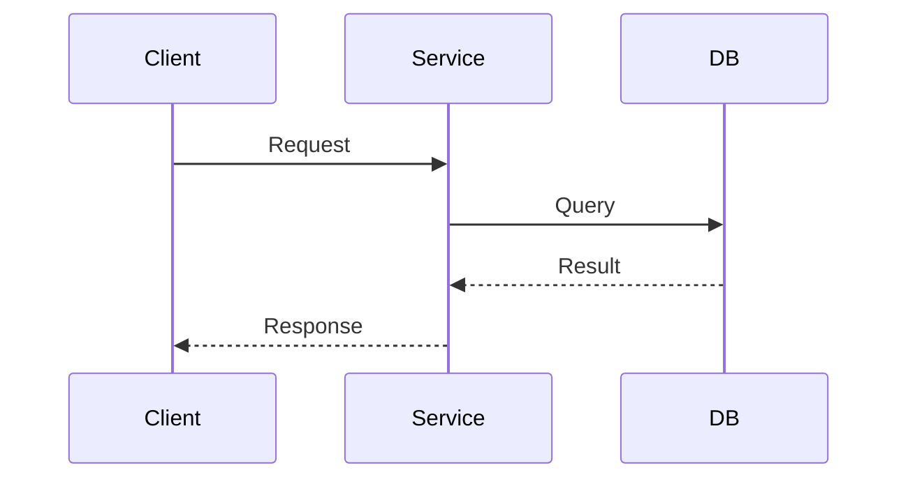
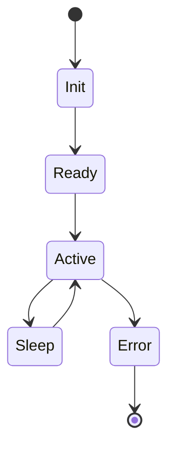

# Key Artefacts Across the Stack: What to Write and Why

Documentation isn't about templates, it's about intent.

<!-- more -->

When I help teams adopt Docs-as-Code, one of the first things I get asked is: _“What exactly are we supposed to write?”_ The idea of using Markdown, version control, and CI pipelines is fine in theory — but what artefacts actually move the needle?

Not all documentation is created equal. Some documents create clarity, alignment, and traceability. Others just create clutter. This post breaks down the artefacts I rely on — across firmware, backend, system integration, and support.

---

## Why Artefacts Matter

Architecture lives in decisions. Integration lives in interfaces. Supportability lives in runbooks. Without artefacts that capture these, everything becomes guesswork:

- Engineers reinvent things that were already tried
- Testers can’t trace features to coverage
- Product teams don’t understand technical constraints
- Ops scramble without context in production

Well-scoped, minimal, linked artefacts make that chaos manageable. They build shared context. They accelerate onboarding. They turn tribal knowledge into engineering memory.

Let’s walk through the artefacts I find most useful — and explain when, why, and how to use them.

---

## 1. Solution Vision

A solution vision isn't a business case — it's a short document that tells engineers and architects _why the system exists_ and what it's supposed to achieve.

### What to include

- Purpose and goals
- Key constraints (technical, operational, compliance)
- Target environments
- Success criteria
- High-level architecture overview

### Format

Plain Markdown. One or two pages max. Include a context diagram and bullet points — not paragraphs of waffle.

---

## 2. Architecture Decision Records (ADRs)

ADRs are the heartbeat of living architecture. One decision per file. Reviewed in PRs. Linked to features and commits.

### Typical structure

- Title
- Context
- Decision
- Consequences
- Alternatives considered

### Example

```markdown
# ADR-003: Use MQTT for Asynchronous Messaging

## Context
Low-bandwidth links between devices and cloud services require a lightweight, publish-subscribe protocol.

## Decision
We will use MQTT 3.1.1 over TLS.

## Consequences
- Retry semantics managed by QoS
- Connection lifecycle must be monitored
- Ingress service must parse retained messages

## Alternatives
- CoAP (harder to integrate with analytics)
- REST (no pub/sub pattern)
```

---

## 3. RFCs and Proposals

RFCs are like ADRs in draft form — they define intent before commitment. I use them for big cross-team changes.

- Describe options
- Include diagrams and flowcharts
- Propose a path, ask for comments
- Reference the final ADR when approved

---

## 4. Technical Risk Registers

Architecture isn’t just about solutions — it’s also about uncertainty. That’s where risk logs help.

### Format

| Risk | Impact | Probability | Owner | Mitigation | Status |
|------|--------|-------------|-------|------------|--------|
| Power brownouts on wake | High | Medium | Firmware | Retry logic, capacitor buffer | Mitigated |
| Message loss due to handshake errors | High | High | Backend | Introduce retry & ack model | Open |

These help drive conversations in arch reviews. I tag risks to ADRs or RFCs when relevant.

---

## 5. Interface & Integration Specifications

No system is standalone. You need to document:

- Hardware pinouts and signal timing
- API endpoints and message formats
- Serial command structures
- Webhooks and async events
- Timing diagrams and FSMs

Use diagrams like:



And make sure every message has byte-level format or schema examples in Markdown tables.

---

## 6. Deployment Views

Explain where the system runs and how it's composed:

- RTOS? Linux? Container?
- Bare-metal? Virtualised? Cloud-managed?
- How do updates work?
- What depends on what?
- Where are the bottlenecks?

Use C4 container or deployment diagrams and embed them with the service/firmware/component docs they apply to.

---

## 7. Runbooks and Support Docs

When something breaks at 3 a.m., this is the doc that gets opened.

It should include:

- How to access logs
- What alerts mean
- Startup/shutdown process
- Known issues and recovery steps
- Config files and meaning

Keep these short. Use bold headings. Use checklists. Add flowcharts or timelines where relevant.

---

## 8. Test and Verification Strategies

Most teams underdocument how they test and why it’s sufficient.

Document:

- What’s unit-tested vs integration-tested
- Test coverage targets
- Edge cases or gaps (with rationale)
- CI requirements
- Test data sources

And always link these back to features, interfaces, or decisions.

---

## 9. Diagrams – Embedded, Not Separate

Diagrams aren’t artefacts — they’re views that support other artefacts.

Embed:

- Sequence diagrams in interface specs
- C4 component diagrams in deployment docs
- State machines in firmware logic overviews
- Data flow in transformation pipelines



Keep diagrams versioned, human-readable (Mermaid, PlantUML), and in the same folder as the markdown they support.

---

## 10. Traceability

The best systems are traceable. I use frontmatter metadata and cross-links to show:

- Requirements → Features → ADRs → Code → Test Cases
- RFCs → Risks → Mitigations → Interfaces
- Artefact → Diagram → Source

Tagging every artefact with `component`, `feature`, `owner`, and `status` helps enable:

- Indexing
- CI-based validation
- Documentation audits

---

## Summary

When people say "we need better docs", they don’t mean more pages — they mean better artefacts.

Artefacts that:

- Explain decisions
- Define interfaces
- Capture risk
- Enable testing
- Reduce support friction
- Survive team changes

Start with the ones that support your architecture. Use markdown. Keep them short. Link them together. Review them like code.

The goal isn’t to be ISO-compliant — it’s to build systems that other people can understand, extend, and support.

---

📘 Next in the series: [Frameworks That Bring Order to Documentation](2025-05-15-documentation-frameworks.md)
