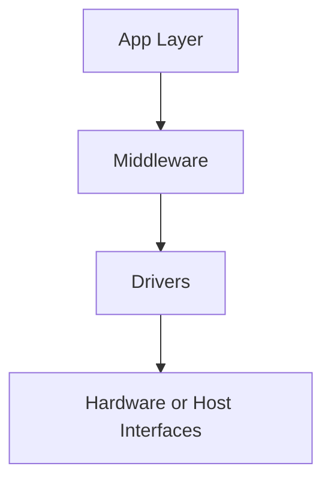
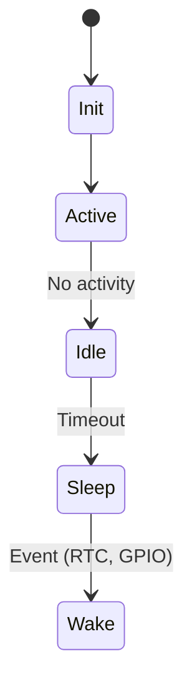

# Writing a Software Design Specification (SDS) Using Docs-as-Code

A Software Design Specification (SDS) should be the living, central document that expresses how your software system works — from architecture to scheduling, interfaces to timing, limitations to traceability. It’s the backbone of software quality, design reasoning, and cross-team understanding.

<!-- more -->

But too often, SDSs end up as dead PDFs written once before code begins and never updated again. That's a mistake. Whether you're working on a distributed platform, a real-time embedded system, or something in between — your SDS should grow with the system it describes.

This post explains how to create a modular, version-controlled SDS using a Docs-as-Code approach. It details the folder structure and what each section should contain. It also shows how it ties into the wider engineering workflow including ADRs, RFCs, and interface specs.

---

## Recommended SDS Structure

```plaintext
docs/
├── adr/
├── rfc/
├── interfaces/
│   ├── lwm2m.md
├── diagrams/
├── scripts/
├── sds/
│   ├── index.md
│   ├── architecture.md
│   ├── task-model.md
│   ├── power.md
│   ├── timing.md
│   ├── memory.md
│   ├── updates.md
│   ├── interfaces/
│   │   ├── i2c-protocol.md
│   │   ├── uart-api.md
│   │   ├── nvm-layout.md
│   ├── components/
│   │   ├── rtc.md
│   │   ├── eeprom.md
│   ├── instrumentation.md
│   ├── limitations.md
│   ├── build-system.md
│   └── metadata.yaml
```

Each file is atomic, reviewable, and versioned. Now let’s walk through what should go in each one.

---

## 1. index.md – Introduction and System Overview

- Purpose and audience of the SDS
- Brief on the system context (e.g. mobile app, IoT device, backend service)
- Dependencies on hardware, cloud, network, or other services
- Relevant upstream artefacts: requirement docs, ADRs, RFCs
- Scope boundaries: what’s included, what isn’t

---

## 2. architecture.md – System or Firmware Architecture

- High-level diagrams showing modules, services, interfaces
- Layers: app, drivers, middleware, platform APIs
- Patterns used (e.g. layered, hexagonal, CQRS)
- Component responsibilities
- Optional: MPU, container security, or privilege separation



---

## 3. task-model.md – Threading, Tasks, and Scheduling

- Scheduler model: FreeRTOS, OS scheduler, custom loop
- Task list with purpose, priority, stack usage
- IPC strategy: queues, semaphores, message passing
- Event loops or co-routine flows
- Background and idle handling

| Task Name    | Priority | Trigger     | Comments |
|--------------|----------|-------------|----------|
| Sync Task    | High     | Timer       | Periodic updates |
| UI Task      | Low      | Button IRQ  | User input handling |
| Logging Task | Low      | Event Queue | Flush to UART/log buffer |

---

## 4. timing.md – Timing Budgets and Real-Time Behaviour

- Real-time constraints
- Deadline enforcement strategies
- Task execution windows
- System tick configuration
- Jitter sensitivity
- Time maintenance mechanisms (e.g. RTC, NTP sync)

```yaml
timing-budget:
  ui-refresh: 16ms
  http-retry-timeout: 3s
  i2c-isr-max: 5µs
```

---

## 5. power.md – Power Strategy and Constraints

Even in non-battery-powered systems, power optimisation may matter (e.g. thermals, green compute, power caps). In embedded systems, it's often critical.

- Active, idle, sleep, standby modes
- Wakeup sources: timers, GPIO, network events
- Power state transitions and rules
- Peripheral shutdown behaviour
- Boot vs runtime power profiles



---

## 6. interfaces/

### Each file here defines

- Internal APIs (between modules or layers)
- Hardware bus protocols (I2C, SPI, UART, etc.)
- Service APIs (REST, gRPC, MQTT, WebSocket)
- Message formats and error models
- Configuration schemas (YAML, JSON, binary)

Example: `i2c-protocol.md` includes device address, command set, register layout, and CRC approach.

---

## 7. memory.md – Memory Layout

Covers:

- Flash/RAM/NVM use
- Emulated EEPROM usage
- Partition maps for multistage bootloaders or A/B firmware
- Memory guard strategies
- Persistent storage and config areas

```plaintext
0x0000 Bootloader (16KB)
0x4000 App Primary (128KB)
0x24000 Config + Logs (64KB)
```

---

## 8. updates.md – Startup and Upgrade Process

- Reset-to-application sequence
- Bootloader logic and verification
- Firmware image structure: header, CRC, footer
- Upgrade triggers (button, command, version mismatch)
- Rollback or dual-image management
- Upgrade state persistence

---

## 9. components/

Each module has:

- What it does and why it exists
- APIs provided
- Dependencies and initialisation order
- Error handling and retry logic
- Unit or integration test notes (if applicable)

Example: `rtc.md` might include system timebase source, drift behaviour, backup register config.

---

## 10. build-system.md – Build and Compilation

- Toolchain, IDE, Docker image, OS details
- CI build stages
- Profiles: debug, release, test
- Conditional flags and feature toggles
- Linting, formatting, and artefact generation

```c
#ifdef ENABLE_DIAG_UART
    send_log(msg);
#endif
```

---

## 11. instrumentation.md – Debugging and Observability

- Log macros and levels
- Log sinks (UART, syslog, file)
- Runtime diagnostics and debug interfaces
- Special builds or test modes
- Tracing and assertions
- Telemetry (for production systems)

---

## 12. limitations.md – Technical Debt and Constraints

- Deferred decisions
- Known issues or incomplete implementations
- External dependencies or blockers
- Banned functions (e.g. `strcpy`, `malloc`)
- Future work already planned

```markdown
## Limitations

- UART debug shares channel with modem; may delay logs.
- Uses legacy flash layout until migration to dual-bank.
```

---

## 13. `metadata.yaml` – Traceability and Review

Include:

```yaml
owner: "system-architecture"
component: "event-bus"
linked-adr: ["adr-015-use-pubsub"]
linked-rfc: ["rfc-008-async-handling"]
last-reviewed: "2025-05-01"
linked-tests: ["test_pubsub_loss", "test_retry_logic"]
```

---

## Docs-as-Code Tooling

- Markdown for content
- Mermaid or PlantUML for diagrams
- YAML for metadata
- CI for linting, PDF export, review expiry
- Static site generation for dev/stakeholder visibility

```yaml
- name: Build SDS
  run: |
    markdownlint docs/sds/**/*.md
    python scripts/check_metadata.py
    pandoc docs/sds/index.md -o sds.pdf
```

---

## Recap and Benefits

| Practice            | Benefit                                      |
|---------------------|----------------------------------------------|
| Modular files        | Clear ownership and easier reviews          |
| Diagrams as code     | Always up to date, easy to regenerate       |
| Traceability metadata| Links decisions, tests, and components      |
| Docs-as-Code pipeline| Consistency, freshness, automation           |
| Shared mental model  | Cross-team visibility and maintainability   |

---

An SDS built this way doesn’t just document what was implemented — it becomes an architectural memory. And whether you're writing for a cloud platform, embedded product, or something in between, this format ensures your design doc scales with your system — and your team.

📘 This is the last part of the series, which starts with [Docs as Code: What It Is, Who It’s For, and When It Works Best](2025-05-12-docs-as-code.md).
