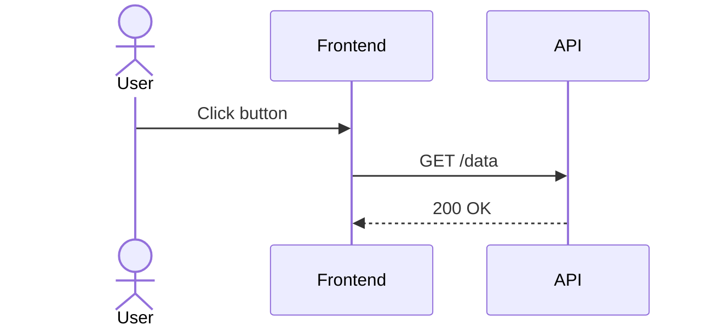

# Templates, Starter Kits and Metadata Playbooks

Every Docs-as-Code journey starts with good intentions. But without structure, even the most motivated team quickly hits friction. What’s the right format for an ADR? Where should we store risk logs? Who owns what, and how do we make it visible?

<!-- more -->

This post answers those questions with a practical starter kit: templates, metadata schemas, diagrams, and CI scripts to help you scale Docs-as-Code cleanly and consistently. It’s written for dev teams either spinning up a fresh documentation setup, or trying to bring discipline to an evolving tangle of artefacts.

Let’s get you scaffolding with confidence.

---

## Why Templates Matter

Templates give teams a **shared language and a clear starting point**. Instead of bikeshedding over headings or structure, contributors can focus on content. And when used consistently with frontmatter metadata, templates drive traceability, review automation, and reuse.

---

## Template Library Overview

| Artefact Type       | Filename                      | Purpose                            |
|---------------------|-------------------------------|-------------------------------------|
| ADR                 | `adr/adr-xxx-title.md`        | Record key technical decisions      |
| RFC                 | `rfc/rfc-xxx-title.md`        | Propose system/feature changes      |
| Risk Register       | `risks/feature-xyz.md`        | Track risks + mitigation            |
| Vision Doc          | `vision/product-name.md`      | Describe goals and drivers          |
| Interface Contract  | `interfaces/system-api.md`    | Define API fields and flows         |
| Runbook             | `runbooks/service-alert.md`   | Document on-call responses          |

---

## ADR Template

```markdown
---
title: "ADR-001: Use MQTT for Ingestion"
owner: "platform-team"
status: "active"
component: "telemetry-ingestion"
last-reviewed: "2025-02-01"
---

## Context

## Decision

## Consequences

## Alternatives Considered

## Related Artefacts
- [RFC-002: Transport Protocols](../rfc/rfc-002.md)
```

---

## RFC Template

```markdown
---
title: "RFC-005: Redesign Authentication Flow"
status: "draft"
author: "auth-team"
linked-components: ["auth-service", "api-gateway"]
---

## Summary

## Motivation

## Design

## Impact Assessment

## Feedback Log

## Review History
```

---

## Risk Register Template

```markdown
---
title: "Config Service Risks"
owner: "team-infra"
component: "config-api"
last-reviewed: "2025-01-15"
---

## Summary

## Risks Table

| Risk                                | Likelihood | Impact | Mitigation           |
|-------------------------------------|------------|--------|-----------------------|
| Downtime during rollout             | Medium     | High   | Blue-green deploy     |
| Auth token expiry issues            | High       | Medium | Refresh buffer added  |
```

---

## Vision Document Template

```markdown
---
title: "Product X - High-Level Vision"
owner: "product-owner"
status: "active"
component: "platform"
---

## Goals

## Stakeholders

## Success Criteria

## Non-Goals

## Roadmap Overview
```

---

## Interface Contract Template

```markdown
---
title: "MQTT Ingestion Protocol"
component: "telemetry-service"
owner: "integration-team"
last-reviewed: "2025-02-05"
---

## Summary

## Fields

| Field     | Type   | Description             |
|-----------|--------|-------------------------|
| device_id | UUID   | Unique device identifier|
| ts        | int64  | Timestamp (epoch ms)    |
| val       | float  | Reported value          |

## QoS, Retention, Security

## Error Handling

## Related Artefacts
```

---

## Frontmatter Metadata Schema

Common fields used in our starter kit:

```yaml
title: "Document Title"
owner: "team-name"
component: "component-name"
status: "draft | active | deprecated"
last-reviewed: "YYYY-MM-DD"
next-review: "YYYY-MM-DD"
linked-features: []
linked-tests: []
tags: []
```

### Why it matters

- Enables dashboards for stale docs
- Groups artefacts by component or team
- Helps automate traceability and audits

---

## Diagram Examples and Embedding

### Embedded Mermaid (in Markdown)



### C4 via Structurizr DSL

```dsl
container auth-service {
    technology "Node.js"
    description "Handles token issuance"
}
```

### Folder example

```plaintext
docs/
├── adr/
├── rfc/
├── risks/
├── interfaces/
├── diagrams/
│   ├── auth-flow.mmd
│   ├── ingestion.dsl
```

Store diagram sources next to the artefacts that embed or reference them.

---

## GitHub Actions / CI Integration

### Linting and Metadata Validation

```yaml
- name: Markdown Lint
  run: markdownlint '**/*.md'

- name: Check Metadata
  run: python scripts/validate_frontmatter.py
```

### PDF/Word Export for Stakeholders

```bash
pandoc docs/interfaces/mqtt.md -o mqtt.docx
```

### Stale Document Warnings

```bash
python scripts/check_review_dates.py --threshold 365
```

---

## Folder Structure and Starter Repo

```plaintext
docs/
├── adr/
├── rfc/
├── risks/
├── vision/
├── interfaces/
├── tests/
├── runbooks/
├── diagrams/
├── templates/
│   ├── adr-template.md
│   ├── rfc-template.md
│   ├── interface-template.md
├── scripts/
│   ├── validate_frontmatter.py
│   ├── check_review_dates.py
```

We bundle the above into a GitHub repo with:

- Starter templates
- Python lint/validate/export scripts
- CI workflows (`.github/workflows/docs.yml`)
- Example rendered site (via MkDocs)

---

## Adoption Playbook for Teams

1. **Clone starter kit**
2. Add project or system-specific folders
3. Define CODEOWNERS
4. Tailor templates per domain
5. Hook up CI + Pandoc exports
6. Demo in sprint review
7. Rotate doc champions per quarter

---

## Summary

| Asset             | Purpose                          |
|------------------|----------------------------------|
| Markdown templates| Scaffolds for consistent docs    |
| Metadata schemas | Enables traceability and CI       |
| Diagram code     | Embeds versionable visuals        |
| CI scripts       | Automate review, export, quality  |
| Folder structure | Provides reuse and scale          |

---

## Final Thoughts

Templates aren’t about rigidity — they’re about repeatability. With a solid starter kit, teams spend less time worrying about structure and more time capturing what matters. **Why decisions were made, how systems work, and how to keep them running**.

Pair that with metadata and CI, and you’ve got documentation that scales — without becoming stale.

---

📘 Next in the series: [Deep Dive into Architecture Decision Records (ADRs)](2025-05-15-adr-deep-dive.md)
